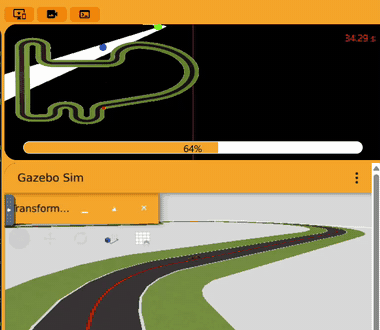
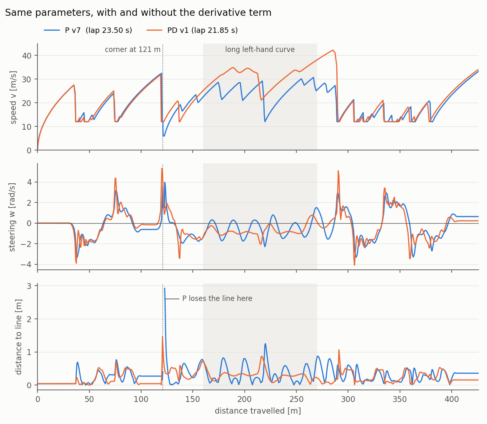
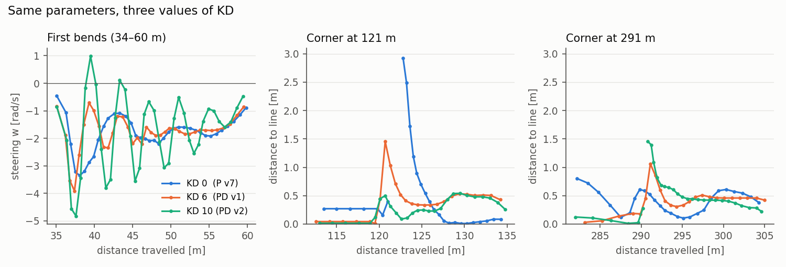
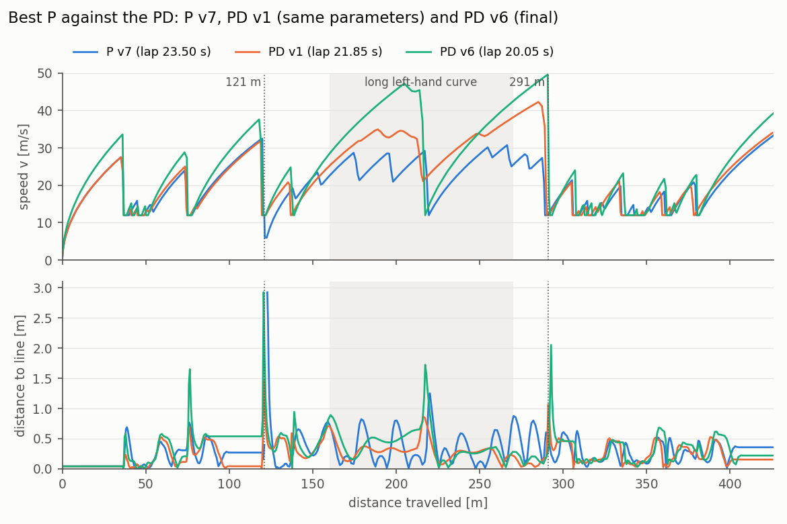
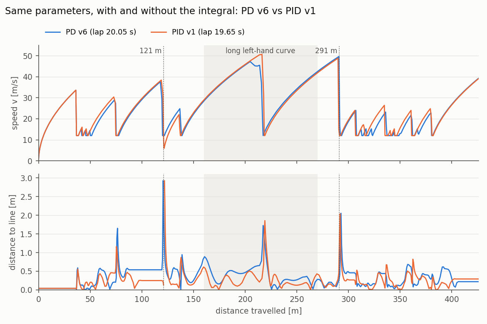
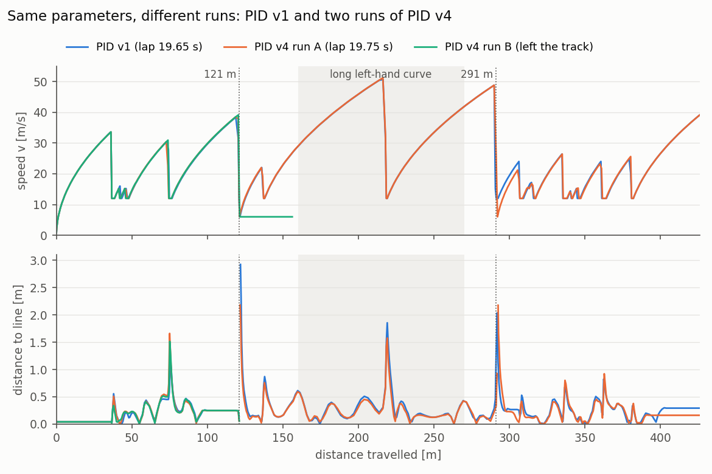
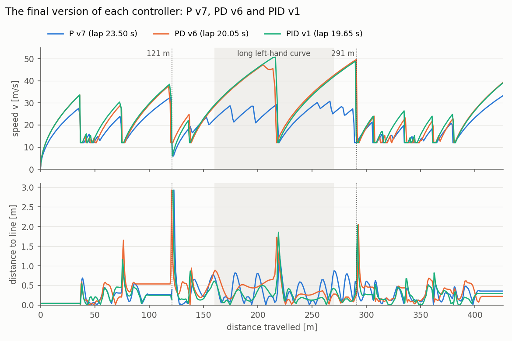

# Follow Line Cars

Three steering controllers, **P**, **PD** and **PID**, for the F1 car of the
[Follow Line exercise](https://jderobot.github.io/RoboticsAcademy/exercises/AutonomousCars/follow_line/)
of JdeRobot Robotics Academy. The goal is to follow the red line of the
**Simple Circuit** as fast as possible with a single front camera. All tests
were run on the **Unibotics** online simulator, with the original Robotics
Backend Docker image (`jderobot/robotics-backend:latest`). Only the controller
code is ours; nothing in the environment was changed.

| Controller | Folder | Status | Best lap (simulated time) |
|---|---|---|---|
| P | [`p_controller/`](p_controller/) | finished (7 versions) | 23.50 s |
| PD | [`pd_controller/`](pd_controller/) | finished (6 versions) | 20.05 s |
| PID | [`pid_controller/`](pid_controller/) | finished (4 versions) | 19.65 s |

**In short:** over one lap, the PD controller is 15 % faster than the best P
controller, and the PID 16 %. The derivative term is what makes the
difference; the integral adds only a small gain on top (section 7).



*The final PID controller (v1) in a corner of the Simple Circuit, in
Unibotics.*

---

## 1. Where everything is

```
Follow Line Cars/
├── README.md            this page: overview and comparison of the controllers
├── comparison/          figures of this page
├── p_controller/
│   ├── README.md        how the P controller works and how it was tuned (v1 to v7)
│   ├── p_controller.py  the code to paste into Unibotics
│   └── results/         lap CSVs, screenshots, videos, GIFs and figures
├── pd_controller/
│   ├── README.md        how the PD controller works and how it was tuned (v1 to v6)
│   ├── pd_controller.py
│   └── results/
└── pid_controller/
    ├── README.md        how the PID controller works and how it was tuned (v1 to v4)
    ├── pid_controller.py
    └── results/
```

Each controller folder is self-contained. Its README explains the code, how
to run it in Unibotics, how to get the lap data, and every test with its
parameters, results and the reason for the next change.

**How to run a controller:**

1. Start the original Robotics Backend:

   ```bash
   docker run --rm -it -p 6080-6090:6080-6090 -p 7163:7163 jderobot/robotics-backend:latest
   ```

2. Open <https://unibotics.org>, open **Follow Line**, keep the **Simple
   Circuit** and press **Connect**.
3. Paste the whole content of `p_controller.py`, `pd_controller.py` or
   `pid_controller.py` into the editor and press **Play**. Press **Reset**
   before every new run.

Each controller's README explains how to copy the lap CSV out of the
container.

---

## 2. What we did

**One code base, three steering laws.** The three controllers share the same
code for everything except the steering law:

* **Perception.** A red mask in HSV, and the position of the line at a *far*
  point (about 4–13 m ahead, sees corners coming) and a *near* point (about
  0.5–1.5 m ahead, keeps the car on the line).
* **Speed policy.** Full speed (`V_MAX`) while the far point is centred.
  Braking towards `V_MIN` as soon as it moves sideways, which happens before
  the corner. Acceleration limited to `ACCEL` per frame.
* **Telemetry.** A console report every 2 s of simulated time, a
  `LAP SUMMARY` after one lap, and a CSV file with one row per camera frame
  (speed, steering, distance to the line, frames without the line).

So any difference between P, PD and PID comes from the steering law alone.

**Lap time measured in simulated time.** The Unibotics timer counts
wall-clock time, so it depends on how fast the computer runs the simulation.
The same P configuration took 97.36 s on battery and 61.00 s plugged in, with
the same 26.0 s of simulated time. All comparisons therefore use the
**simulated lap time** from the CSV (frames × 50 ms until 425 m have been
driven). Differences below about 0.5 s are treated as ties.

**Tuning from data, one lap at a time.** Each version is driven for one lap.
Its CSV shows where time is lost (braking, weaving, slow exits), and that
decides the next change. The P controller went from the class example (a
456 s lap on the timer) to a 23.50 s simulated lap in seven versions, the PD
from there to 20.05 s in six more, and the PID to 19.65 s. The PD started
directly from the best P values, adding only the derivative term, and the PID
from the best PD values, adding only the integral term. At the highest speeds,
one lap per version was no longer enough to judge a setting (section 6).

---

## 3. The three control laws

All three compute the same error `e = FAR_WEIGHT · e_far + (1 − FAR_WEIGHT) · e_near`
(the position of the line in the image, from −1 to 1) and turn the car with an
angular speed `w`:

| Controller | Steering law | What the new term does |
|---|---|---|
| P | `w = KP · e` | Turns towards the line, more the further away it is |
| PD | `w = KP · e + KD · d` | `d` = how fast the error changes. Damps the weaving and reacts early when a corner begins |
| PID | `w = KP · e + KD · d + KI · i` | `i` = accumulated error. Reduces the constant offset that P and PD keep in long curves |

What each term is expected to fix:

* **P alone** needs an error to turn, so in a long curve it rides on the
  outside of the line. It also has nothing to stop an overshoot, so speed and
  steering oscillate together in the curves.
* **The derivative** reacts to the *change* of the error. It reduces the turn
  when the car is already returning to the line, and adds turn when the error
  starts growing at a corner entry.
* **The integral** grows while the error stays on one side. It provides the
  constant turn a long curve needs, so the error gets smaller. In the code it
  is "leaky" and clamped so that it does not keep turning after the curve ends;
  because of the leak, it reduces the error but does not remove it.

---

## 4. Results

| Controller | Version | Simulated lap | Unibotics timer (RTF) | Line lost | Distance to the line, mean / max | Mean speed |
|---|---|---|---|---|---|---|
| P | v7 (final) | 23.50 s | 54.95 s (0.43) | 5 frames | 0.29 / 2.93 m | 18.1 m/s |
| PD | v1 (same parameters as P v7) | 21.85 s | 56.51 s (0.39) | never | 0.23 / 1.45 m | 19.5 m/s |
| PD | v6 (final) | 20.05 s | 47.51 s (0.43) | **never** | 0.34 / 2.93 m | 21.2 m/s |
| PID | v1 (final, same parameters as PD v6) | **19.65 s** | 56.16 s (0.35) | 2 frames | 0.28 / 2.92 m | **21.7 m/s** |

The comparisons use the simulated lap. The timer is given only for reference:
it depends on the RTF of each run (section 2). For example, PID v1 is the
fastest lap in simulated time but not on the timer, because it ran at a lower
RTF.

---

## 5. P vs PD with the same parameters

PD v1 uses **exactly the same parameters as P v7** (`KP` 4, `V_MAX` 45,
`V_MIN` 12, `E_BRAKE` 0.5, `ACCEL` 0.55, `FAR_WEIGHT` 0.85). It only adds the
derivative term (`KD` 6, `D_ALPHA` 0.7). That makes these two laps a direct
comparison of the two methods.



*Speed, steering and distance to the line along the lap. Blue: P v7. Orange:
PD v1. Shaded: the long left-hand curve. Dotted line: the corner at 121 m.*

| | P v7 | PD v1 | Difference |
|---|---|---|---|
| Simulated lap | 23.50 s | 21.85 s | **−1.65 s (−7 %)** |
| Line lost | 5 frames (0.25 s) | never | |
| Distance to the line, mean / max | 0.29 / 2.93 m | 0.23 / 1.45 m | |
| Long curve: sign changes of the steering | 11 | 1 | |
| Long curve: speed min / mean | 12.0 / 23.9 m/s | 21.1 / 30.6 m/s | |
| Mean steering change per frame, long curve | 0.26 rad/s | 0.14 rad/s | |
| Mean steering change per frame, whole lap | 0.21 rad/s | 0.26 rad/s | |
| Frames accelerating at the `ACCEL` limit | 77 % | 74 % | |

Where the 1.65 s are gained:

| Section of the lap | P v7 | PD v1 | Difference |
|---|---|---|---|
| 0–115 m (start and first bends) | 7.00 s | 7.05 s | +0.05 s |
| 115–130 m (corner at 121 m) | 1.25 s | 0.90 s | **−0.35 s** |
| 130–160 m | 1.55 s | 1.60 s | +0.05 s |
| 160–270 m (long left-hand curve) | 4.60 s | 3.60 s | **−1.00 s** |
| 270–425 m (chicanes and final straight) | 9.10 s | 8.70 s | **−0.40 s** |

**What the comparison shows:**

1. **The derivative removes the weaving.** In the long curve the P steering
   oscillates around the line and changes sign 11 times. With the derivative
   it changes sign once, and the steering changes are half as large.
2. **Better steering makes the same speed policy faster.** The speed command
   depends only on the far error. When the car weaves, the far error swings
   and the speed policy keeps braking. When it does not weave, the far error
   stays small and the car keeps its speed. In the long curve the P car drops
   to 12 m/s; the PD car never goes below 21 m/s. That curve alone gives 60 %
   of the gain, and the extra speed carries into the next section (another
   0.4 s).
3. **The derivative anticipates.** At the corner at 121 m the error grows
   very fast. The P controller reacted too late and lost the line for 0.25 s.
   The PD reacted to the growth of the error, turned harder at once (5.3
   against 4.0 rad/s) and kept the line.
4. **The price is sharper steering at corner entries.** Over the whole lap the
   PD steering changes more per frame (0.26 against 0.21 rad/s), because the
   derivative produces short, strong turns when a corner begins.
5. **Acceleration is the next limit.** Both laps spend about 75 % of the time
   accelerating at the `ACCEL` limit. For the P controller, steering was a limit
   too: it lost the line at 121 m, and with more speed (P v6) it left the
   track. The PD's extra margin (no lost frames, half the maximum distance to
   the line) is what allowed the higher speeds of the later PD versions (see
   below).

The sections where neither controller weaves (0–115 m, 130–160 m) take the
same time with both. This confirms that the derivative only changes the
result where the P controller oscillated or reacted late.

### How much derivative? KD 0, 6 and 10

PD v2 repeated PD v1 with `KD = 10`, again changing nothing else. With P v7
(`KD = 0`), this gives three laps that differ only in the derivative gain:

| | KD 0 (P v7) | **KD 6 (PD v1)** | KD 10 (PD v2) |
|---|---|---|---|
| Simulated lap | 23.50 s | **21.85 s** | 22.25 s |
| Line lost | 5 frames | **never** | 1 frame |
| Max distance to the line at the corner at 121 m | 2.92 m | 1.45 m | **0.54 m** |
| Steering zigzag frames | 1 | 5 | 24 |
| Mean steering change per frame | 0.21 rad/s | 0.26 rad/s | 0.46 rad/s |



*Steering in the first bends, and distance to the line at the two critical
corners, for the three values of `KD`.*

* **Too little derivative (`KD = 0`):** the car weaves in the long curve and
  reacts late at corner entries.
* **Too much derivative (`KD = 10`):** the anticipation is even better (0.54 m
  at the corner at 121 m), but the derivative reacts to its own corrections.
  The steering zigzags with a period of about 0.3 s in the slow bends, and at
  the fastest corner entry (291 m, 43 m/s) the steering kick is so strong that
  the line leaves the image for one frame.
* **In between (`KD = 6`)** gives the fastest lap and the best margin. This is
  the classic trade-off of the derivative term: damping and anticipation
  against sensitivity to noise and to its own corrections.

### Beyond the speed limit of the P controller

The P controller reached its limit at the corner at 121 m. P v7 lost the line
there for 0.25 s, and P v6 (`V_MAX` 50, `ACCEL` 0.6) left the track after
reaching 33.6 m/s. PD v3 keeps `KD = 6` and uses even higher speeds (`V_MAX`
55, `ACCEL` 0.65):

| | P v6 | P v7 | PD v3 |
|---|---|---|---|
| `V_MAX` / `ACCEL` | 50 / 0.6 | 45 / 0.55 | 55 / 0.65 |
| Corner at 121 m | left the track | line lost 0.25 s | entered at 34.3 m/s, at most 1.25 m from the line |
| Simulated lap | – | 23.50 s | **21.05 s** |

With the derivative, the car takes the critical corner faster than the speed
at which the P controller failed, and it never loses the line. That is the
practical meaning of the extra damping and anticipation: it allows **2.45 s**
less per lap (−10 %) than the best P, without losing the line once.

The last PD versions pushed the speeds further. PD v5 (`V_MAX` 85, `ACCEL`
0.8) left the track at the corner at 291 m, and the final **PD v6**
(`V_MAX` 80, `ACCEL` 0.8) completed the lap in **20.05 s**, 3.45 s (−15 %) faster than P v7, without losing the
line. It has no margin left: at the corner at 121 m it ends 2.93 m from the
line, the distance at which P v7 lost it. The derivative moved the limit to
higher speeds, but did not remove it.



*Speed and distance to the line along the lap. Blue: the best P (v7).
Orange: PD v1, the same parameters plus the derivative. Green: the final PD
(v6), with higher speeds.*

---

## 6. PD vs PID with the same parameters

PID v1 uses **exactly the same parameters as PD v6** and only adds the
integral term (`KI` 0.1, `I_DECAY` 0.95, `I_MAX` 10). As with P v7 and PD v1,
these two laps compare the two methods directly.



*Speed and distance to the line along the lap. Blue: PD v6. Orange: PID v1.
Same parameters; the only difference is the integral term.*

| | PD v6 | PID v1 | Difference |
|---|---|---|---|
| Simulated lap | 20.05 s | 19.65 s | **−0.40 s (−2 %)** |
| Line lost | never | 2 frames at 121 m | |
| Distance to the line, mean / max | 0.34 / 2.93 m | 0.28 / 2.92 m | |
| Long curve: mean error | −0.22 | −0.14 | −37 % |
| Long curve: mean distance to the line | 0.43 m | 0.33 m | |

Where the 0.40 s are gained and lost:

| Section of the lap | PD v6 | PID v1 | Difference |
|---|---|---|---|
| 0–115 m (start and first bends) | 6.20 s | 5.95 s | **−0.25 s** |
| 115–130 m (corner at 121 m) | 0.80 s | 1.00 s | +0.20 s |
| 130–160 m | 1.50 s | 1.55 s | +0.05 s |
| 160–270 m (long left-hand curve) | 3.45 s | 3.40 s | −0.05 s |
| 270–425 m (chicanes and final straight) | 8.10 s | 7.75 s | **−0.35 s** |

**What the comparison shows:**

1. **The integral reduces the constant error, as expected.** In the long curve
   the mean error drops by 37 %. It does not drop to zero, because the integral
   of the code forgets old errors (`I_DECAY`) so that it does not keep turning
   after a corner. With that leak, the theory predicted about one third.
2. **It pays off where the curvature keeps the same direction.** In the first
   bends the car stays closer to the line, brakes less and saves 0.25 s. The
   chicanes are 0.35 s faster too, without windup problems.
3. **Its weak point is the image stall.** Just before the corner at 121 m the
   camera image freezes for about 1 s. The integral keeps adding the frozen
   error, so the steering drifts while the car sees nothing new, and the line
   is then lost for 2 frames at that corner (+0.20 s).
4. **The gain is much smaller than that of the derivative.** 0.40 s is within
   the ±0.5 s tie margin, against 1.65 s for the derivative with the same
   parameters.

### How much integral? KI from 0 to 0.15

| `KI` | Best completed lap (simulated) | Result |
|---|---|---|
| 0 (PD v6) | 20.05 s | line kept |
| **0.1 (PID v1)** | **19.65 s** | line lost for 2 frames; completes the lap in some runs |
| 0.11 (PID v4) | 19.75 s | completed the lap in 2 of 3 runs |
| 0.12 | – | completes the lap in some runs |
| 0.125 (PID v3) | 19.9 s | completed once, then left the track |
| 0.15 (PID v2) | – | left the track at the corner at 121 m |

More integral makes the car worse at the corner at 121 m and does not make
the completed laps faster, so `KI = 0.1` is the final value.

### Repeatability at the limit

At the speeds of the final controllers, the result of a lap is not fully
repeatable. This was tested with the PID. In one session, PID v4 was run three
times in a row with the same values: the first and third runs completed the lap, and the second one
left the track. The PID with `KI = 0.1` also completes the lap only in some
runs. The decisive point is always the corner at 121 m, which the car reaches
right after an image stall:



*Blue: PID v1. Orange: PID v4, a completed run. Green: PID v4, the run that
left the track. The three runs drive almost the same until the corner at
121 m, where the outcome is decided.*

| Lap | Speed entering the corner at 121 m | Result at that corner |
|---|---|---|
| PD v6 | 37.6 m/s | line kept, 2.93 m away |
| PID v1 | 38.4 m/s | line lost for 2 frames, found again |
| PID v4, completed run | 38.4 m/s | line lost for 1 frame, found again |
| PID v4, failed run | 39.1 m/s | line lost, left the track |

The tests used one lap per version, which was enough while the car had
margin. At the limit, a single lap shows that a setting *can* complete the
lap, not that it always will. The PID can also leave the track in the second
lap, like the PD, but only sometimes.

---

## 7. Conclusions

| Controller | Final version | Simulated lap | Against the best P | Line lost in that lap |
|---|---|---|---|---|
| P | v7 | 23.50 s | – | 5 frames |
| PD | v6 | 20.05 s | −3.45 s (−15 %) | never |
| PID | v1 | **19.65 s** | **−3.85 s (−16 %)** | 2 frames |



*Speed and distance to the line along the lap, for the final version of each
controller.*

* **The derivative is the term that matters most on this circuit.** With the
  same parameters it saved 1.65 s, and its damping and anticipation allowed
  much higher speeds: the P controller left the track with `V_MAX` 50 and
  `ACCEL` 0.6, while the PD completes the lap with 80 and 0.8.
* **The integral adds a small gain on top** (0.40 s with the same
  parameters), where the curvature keeps the same direction. But it reacts
  badly to image stalls and does not make the controller more robust: at
  these speeds the PID completes the lap only in some runs.
* **All three end up limited by the same things:** the corner at 121 m,
  reached at about 38 m/s right after an image stall, and the acceleration
  limit on the straights (the speed is rising at the `ACCEL` limit in 77–84 %
  of the frames of the three final laps).
* **The settings are for one lap from a standstill**, which is what the
  exercise measures. They are not valid for consecutive laps: the first lap
  ends on the long straight at about 39 m/s, the car keeps accelerating across
  the start line, and it reaches the first corner of the second lap at an
  estimated ~52 m/s instead of 33.6 m/s. The final PD left the track there in
  the test that was made; the final PID does so only sometimes.
* **At the limit, one lap per version is not enough.** The tuning method
  worked while the car had margin, but the fastest settings complete the lap
  only in some runs (section 6). A more robust choice would give up about one
  second per lap for margin, for example the PD v3 setting: 21.05 s, with the
  line never lost and never more than 1.45 m away in its lap (it was not
  repeated over several runs).
