# Follow Line – P controller

A **proportional (P)** steering controller for the F1 car of the
[Follow Line exercise](https://jderobot.github.io/RoboticsAcademy/exercises/AutonomousCars/follow_line/)
of JdeRobot Robotics Academy. It was developed and tested on the **Unibotics**
online simulator (Simple Circuit), using the original Robotics Backend Docker
image. Only the controller code is ours; nothing in the environment was changed.

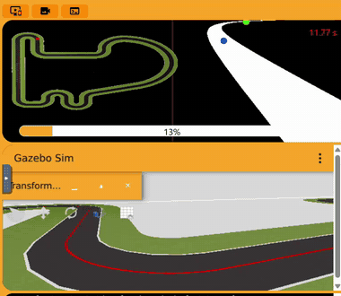

*The P controller (v5) in a corner of the Simple Circuit, in Unibotics.*

| | |
|---|---|
| **Final version** | v7, [`p_controller.py`](p_controller.py) |
| **Lap time, simulated** (from the lap CSV) | **23.50 s** |
| Lap time, Unibotics timer | 54.95 s (RTF 0.43 on the test laptop) |
| Line lost during the lap | 5 frames (0.25 s) in one corner, then found again |
| Distance to the line, mean / max | 0.29 m / 2.93 m |

---

## 1. How to run

1. Start the original Robotics Backend:

   ```bash
   docker run --rm -it -p 6080-6090:6080-6090 -p 7163:7163 jderobot/robotics-backend:latest
   ```

2. Open <https://unibotics.org>, open **Follow Line**, keep the **Simple
   Circuit** and press **Connect**.
3. Paste the whole content of [`p_controller.py`](p_controller.py) into the
   editor and press **Play**. Press **Reset** before every new run.

The image panel shows the debug view: the red mask in white, the **far** point
(green), the **near** point (blue) and the image centre (red vertical line).
The console prints a report every 2 s of simulated time and a `LAP SUMMARY`
line after one lap.

**Getting the lap data.** Every run writes a CSV file inside the container. The
console prints its name when the run starts (`Logging this run to
/tmp/P_HHMMSS.csv`). Copy it from a second terminal **before stopping the
container**, because `--rm` deletes the container together with its files:

```bash
docker ps
```

```bash
docker exec CONTAINER_NAME sh -c "ls /tmp/*.csv"
```

```bash
docker cp CONTAINER_NAME:/tmp/P_103055.csv .
```

`CONTAINER_NAME` is the value in the `NAMES` column of `docker ps` (for
example `gracious_zhukovsky`). `P_103055.csv` is an example file name.

---

## 2. How it works

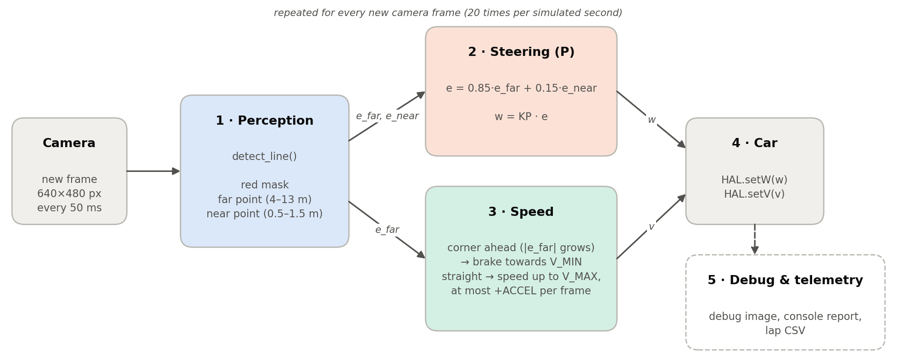

Every new camera frame goes through the same five steps:

1. **Perception** (2.1): find the red line and measure how far it is from the
   image centre at a far point and a near point. This gives the errors `e_far`
   and `e_near`.
2. **Steering** (2.2): the P law turns the car towards the line, `w = KP · e`.
3. **Speed** (2.3): brake when the far point shows that a corner is coming, and
   accelerate on the straights.
4. **Car**: the commands are sent with `HAL.setW(w)` and `HAL.setV(v)`.
5. **Debug and telemetry** (2.5): debug image in the GUI, console report and
   lap CSV. They only measure; they do not change how the car drives.

### 2.1 Perception (`detect_line`)

**What the camera sees.** The F1 camera is 640×480 px with a 90° horizontal
field of view (focal length 320 px). It sits about 0.10 m above the ground and
looks horizontally. The horizon is therefore at row 240, and a point on the
ground at distance *d* appears at row ≈ 240 + 33/*d*:

| image row | 243 | 248 | 256 | 273 | 306 | 400 |
|---|---|---|---|---|---|---|
| distance ahead | ~10 m | ~4 m | ~2 m | ~1 m | ~0.5 m | ~0.2 m |

The useful look-ahead is packed into the first ~15 rows under the horizon. The
big red triangle at the bottom of the image is only about 0.2 m in front of
the car. The example from the class slides follows the centroid of the whole
mask, which sits at row ~398 (see the baseline screenshot in section 4). It
only reacts when the corner is already under the car.

**What the code extracts:**

1. Only the ground half of the image (rows ≥ 242) is processed.
2. Red is detected in HSV with **two hue ranges** (0–10 and 165–180), because
   red wraps around H = 0 in OpenCV.
3. `top` is the first row that contains red, which is the farthest visible
   point of the line. Both bands are placed relative to `top`, not at fixed
   rows. They therefore keep working when the line leaves the image sideways
   in a corner.
4. **Far band**, rows `[top, top+6)`, about 4–13 m ahead: it sees the corner
   coming. **Near band**, rows `[top+20, top+60)`, about 0.5–1.5 m ahead: it
   keeps the car on the line.
5. The centroid of each band is computed with `cv2.moments`. Nothing indexes
   `contours[0]` as the slides' code does, so an empty mask cannot crash the
   program. If only one band sees the line, its value is used for both.
6. Each centroid *cx* becomes a normalised error `e = (320 − cx) / 320` in
   [−1, 1], positive when the line is on the left. Because f = 320 px,
   `e ≈ tan(angle to that point)`.

The camera is mounted 4 cm to the left of the car's centre. So even with the
car exactly on the line, the near point appears slightly to the right of the
image centre in the debug view. This is expected.

### 2.2 Steering: the P law

```
e = FAR_WEIGHT · e_far + (1 − FAR_WEIGHT) · e_near
w = KP · e
```

* `KP = 4`: a line at the edge of the image (`e = 1`) gives 4 rad/s of turn.
* A P controller has no derivative term to anticipate corners, so the
  anticipation comes from the far point (`FAR_WEIGHT = 0.85`). The near point
  keeps the car centred.
* **The weakness of a pure P controller.** In a curve of curvature κ taken at
  speed *v*, the car needs `w = v·κ`. A P controller can only produce a non-zero
  `w` if there is an error, so it settles at `e ≈ v·κ / KP`: it rides on the
  outside of the line, more the faster it goes. Also, every change of speed
  inside a curve changes the turn needed, and nothing damps the overshoot that
  follows. This **coupling between speed and steering** is what limited the
  tuning (section 4).

### 2.3 Speed policy (`target_speed`)

```
v_target = V_MAX − (V_MAX − V_MIN) · min(1, |e_far| / E_BRAKE)
v        = min(v_target, v_previous + ACCEL)
```

* On a straight the far point is centred (`e_far ≈ 0`), so the car runs at
  `V_MAX`. When a corner is coming, the far point moves sideways **before** the
  car reaches it, so the car brakes in advance. It reaches `V_MIN` when
  `|e_far| ≥ E_BRAKE`.
* Braking is instant. Accelerating is limited to `ACCEL` per frame, which is
  `ACCEL / 0.05 s` in m/s² (0.55 → 11 m/s²).
* A number used in section 4 is the **sensitivity** of this policy,
  `S = (V_MAX − V_MIN) / E_BRAKE`: how many m/s the speed command changes per
  unit of far error. With a high `S`, a small wobble of the error produces a
  large change of speed.

### 2.4 Robustness details

* **Only new frames are processed.** `HAL.getImage()` returns the same image
  until the camera (20 Hz) sends a new one. The loop compares a sub-sampled
  copy with the previous image and sleeps 2 ms if nothing changed. The control
  law therefore runs exactly once per frame, and the CPU is left to Gazebo.
* **Start.** The car does not move until it has seen the line, because the
  camera can take a moment to start after **Play**. The console shows
  `Waiting for the red line` in the meantime.
* **Line lost.** The car drops to `V_MIN / 2` and turns at `W_LOST` towards the
  side where the line was last seen. In v7 this found the line again after
  0.25 s. In v6 the car had already left the track, and the search could not
  bring it back (section 4).

### 2.5 Telemetry and lap CSV (`Telemetry` class)

Unibotics only shows the lap timer and the real-time factor (RTF). That is not
enough to compare versions fairly (section 3) or to understand *why* the car
behaves as it does. So we added a measurement block to the controller that
saves the data of every frame. It does not influence how the car is driven.

* A console report every 40 frames (2 s of simulated time). The `LAP SUMMARY`
  line is printed once 425 m have been driven. The red line is 429 m long, and
  the car cuts the corners slightly. Logging stops there, so each CSV holds
  exactly one lap.
* One CSV row per frame:

| Column | Meaning |
|---|---|
| `sim_time` | Simulated time = frames × 0.05 s. The camera produces one frame every 50 ms of simulated time |
| `dist` | Distance travelled = Σ v · 0.05 s. The F1 model applies the commanded speed directly |
| `v`, `w` | Speed and steering commands sent to the car |
| `line_offset` | Distance [m] between the car's centre line and the red line. It is estimated from the camera geometry at rows 395–405 (≈ 0.2 m ahead) and corrected for the 4 cm camera offset |
| `lost` | 1 if no red was visible in the image |

The `LAP SUMMARY` gives the same values aggregated over the lap. It also
reports the wall-clock time and the RTF, and the mean |Δw| between frames, which
measures how smooth the steering is. For example, the final version printed:

```
LAP SUMMARY [sim 23.5 s | wall 54.4 s | RTF 0.43 | 426 m] speed mean 18.1 max 33.5 m/s |
line offset mean 29.4 max 292.5 cm | steering mean|dw| 0.21 rad/s | lost 5
```

`line_offset` is an estimate, because it also contains a small part of the
heading error. In an offline replica of the circuit (a Python model of the
track, car and camera, used before testing in Unibotics), where the true
distance is known, it was
within a few centimetres of it (mean 20.4 vs 19.2 cm, max 99.4 vs 96.4 cm).

### 2.6 Parameters (final values, v7)

| Parameter | Value | Meaning |
|---|---|---|
| `KP` | 4.0 | steering gain [rad/s per unit of error] |
| `V_MAX` | 45.0 m/s | speed with the far point centred (never reached; see v5 in section 4) |
| `V_MIN` | 12.0 m/s | speed in the tightest corners |
| `E_BRAKE` | 0.5 | far error at which the speed reaches `V_MIN` (line ≈ 27° off-centre) |
| `ACCEL` | 0.55 m/s per frame | maximum speed increase per frame (11 m/s²); braking is instant |
| `FAR_WEIGHT` | 0.85 | share of the far point in the steering error |
| `W_LOST` | 1.5 rad/s | search turn rate if the line is lost |

The telemetry constants (`TELEMETRY`, `REPORT_EVERY`, `CSV_LOG`, `RUN_NAME`,
`LAP_LENGTH`, …) only change what is printed and saved.

---

## 3. Measuring the lap: simulated time, not the timer

The Unibotics timer counts **wall-clock** time (`datetime.now()` in the
exercise's `lap.py`). The car moves in **simulated** time. The two are related
by the RTF = simulated time / real time. When the computer is slower, Gazebo
simulates fewer seconds per real second. The same lap then takes longer on the
timer, even though the car does exactly the same thing.

This happened with v4, which was run twice with the same code on the same
laptop:

| v4 run | Laptop | Timer | RTF (`LAP SUMMARY`) | Simulated lap |
|---|---|---|---|---|
| A | on battery, just woken from sleep (power saving) | **97.36 s** | 0.27 | **26.0 s** |
| B | plugged in | **61.00 s** | 0.43 | **26.0 s** |

| A: on battery | B: plugged in |
|---|---|
| [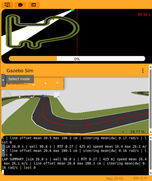](results/p_v4_lap_time_savemodelaptop.png) | [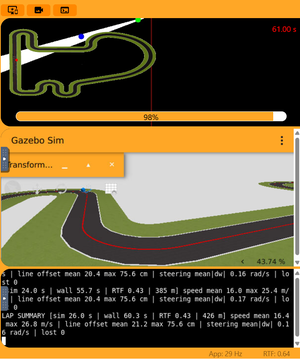](results/p_v4_lap_time_laptopcharging.png) |

The timer went from 97 s to 61 s, but the simulated lap is identical. The
timer measures the computer as much as the controller. v5 shows the opposite
trap: its timer (65.37 s) is *higher* than v4-B (61.00 s), even though v5 is
1.35 s faster in simulated time. It simply ran at a lower RTF (0.39 vs 0.43).

**So all comparisons use the simulated lap time from the CSV:** the
`sim_time` of the first row where `dist` reaches 425 m. The `LAP SUMMARY` gives
the same value, rounded. The timer is still reported, always together with its
RTF. Each version was driven once, and the 425 m end point depends slightly on
how the car cuts the corners. So **differences below about 0.5 s are treated as
ties**. The two v4 runs also show the run-to-run spread of the distance to the
line: max 1.00 m in A against 0.76 m in B.

---

## 4. Tests: from the baseline to v7

**Method.** Each version was driven for one lap on the Simple Circuit, with
**Reset** before each run. For every lap we kept the timer screenshot with the
`LAP SUMMARY`, a video of the same section of the circuit (baseline to v5), and
the lap CSV (v1 to v5, and v7). Each new set of parameters was chosen from the
data of the previous lap.

`KP = 4.0` was kept in every version. It came from a preliminary tuning in the
offline replica of the circuit. On the straights the
steering was always smooth: the distance to the line stayed ≤ 4 cm in the first
30 m of every lap. So the steering gain alone was never the problem.

| Version | V_MAX | V_MIN | E_BRAKE | ACCEL | FAR_W. | **Sim lap** | Timer (RTF) | Mean speed | Dist. to line mean / max |
|---|---|---|---|---|---|---|---|---|---|
| Baseline | 6 (constant) | – | – | – | – | – | 456.40 s | 6 m/s | – |
| v1 | 12 | 4 | 0.25 | 0.3 | 0.70 | **61.15 s** | 211.50 s (0.29) | 7.0 m/s | 0.12 / 0.31 m |
| v2 | **20** | **10** | 0.25 | **0.4** | 0.70 | **32.90 s** | 91.03 s (0.37) | 12.9 m/s | 0.09 / 0.25 m |
| v3 | **30** | **15** | 0.25 | 0.4 | 0.70 | **26.10 s** | 72.56 s (0.30) | 16.3 m/s | 0.24 / 1.34 m |
| v4 | 30 | **12** | **0.5** | **0.3** | **0.85** | **26.00 s** | 61.00 s (0.43) | 16.4 m/s | 0.21 / 1.00 m |
| v5 | **34** | 12 | 0.5 | **0.4** | 0.85 | **24.65 s** | 65.37 s (0.39) | 17.3 m/s | 0.25 / 0.86 m |
| v6 | **50** | 12 | 0.5 | **0.6** | 0.85 | off track at ~121 m | – | – | – |
| **v7** | **45** | 12 | 0.5 | **0.55** | 0.85 | **23.50 s** | 54.95 s (0.43) | 18.1 m/s | 0.29 / 2.93 m |

Bold parameters changed from the previous version (v7 is compared with v6).
`KP = 4.0` in all versions. v1 to v5 never lost the line. v6 lost it and never
found it again. v7 lost it for 5 frames (0.25 s). The v4 CSV is from run A
(section 3).

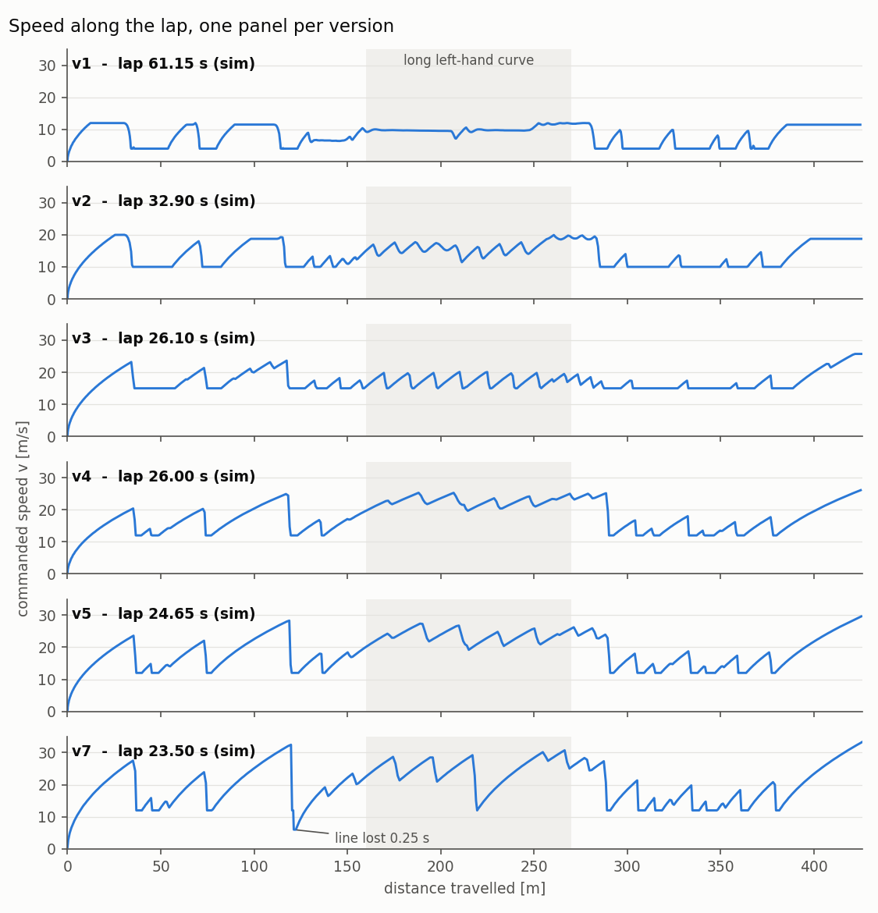

*Commanded speed along the lap, from the CSVs. The flat stretches at the
bottom are the corners at `V_MIN`; the ramps are the `ACCEL` limit. In v7 the
drop to 6 m/s at ~121 m is the moment the line was lost.*

The videos are screen recordings in real time. With an RTF of about 0.3–0.4,
the car looks 2.5–3 times slower than it is in simulated time.

### Baseline: the example from the slides

[`baseline_slides.py`](baseline_slides.py) follows the centroid of the whole
red mask at a constant 6 m/s, with `w = 0.01 · (320 − cX)`.

**Result:** 456.40 s on the timer. The car weaves from side to side in the
corners. The baseline has no telemetry, so there is no simulated time. At a
constant 6 m/s, though, it needs at least ~71 s of simulated time for 425 m.
The reasons are what the design of section 2 addresses:

* It looks only about 0.2 m ahead (centroid at `cY ≈ 398`), so it reacts late
  and overshoots → **far and near bands**.
* Its speed is the same on straights and in corners → **speed policy**.
* The loop runs and prints on every call to `HAL.getImage()`, even when no new
  frame has arrived. The console counter reached 52,030 iterations in that run
  (screenshot), and all of that competes with Gazebo for the CPU → **only new
  frames are processed**.

| Lap completed | Same section of the circuit |
|---|---|
| [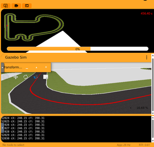](results/baseline_lab.png) | 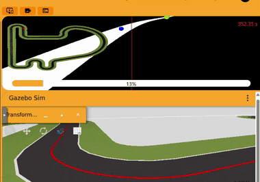 |

[Full video](results/baseline_curve.mp4)

### v1: a safe starting point

The goal of v1 was to complete a lap safely and get a reference. The values
were chosen for that:

* `V_MAX = 12` m/s, twice the baseline speed.
* `V_MIN = 4` m/s, slow enough for the hairpins.
* `E_BRAKE = 0.25`: full braking as soon as the far line is about 14°
  off-centre, so the car brakes early.
* `ACCEL = 0.3` m/s per frame (6 m/s²) and `FAR_WEIGHT = 0.7`.

**Result:** 61.15 s, very smooth and precise (max 0.31 m from the line). But
the car spent **40 % of the lap (24.6 s) at `V_MIN` = 4 m/s**, with a mean speed
of only 7.0 m/s.
**Decision:** there is a large margin, so raise `V_MAX`, `V_MIN` and `ACCEL`.

| Lap completed | Same section of the circuit |
|---|---|
| [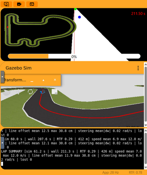](results/p_v1_lap_time.png) | 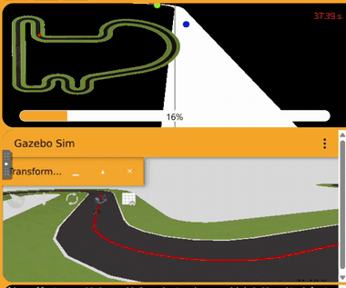 |

[CSV](results/p_v1_lap.csv) · [full video](results/p_v1_curve.mp4)

### v2: faster everywhere

**Changes:** `V_MAX` 12 → 20, `V_MIN` 4 → 10, `ACCEL` 0.3 → 0.4.

**Result:** 32.90 s (**−46 %**), still smooth (max 0.25 m). The car still spent
36 % of the lap at `V_MIN`, and the first small speed oscillations appear in
the long left-hand curve (160–270 m).
**Decision:** the car is still far from its limit, so raise the speeds again.

| Lap completed | Same section of the circuit |
|---|---|
| [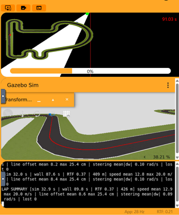](results/p_v2_lap_time.png) | 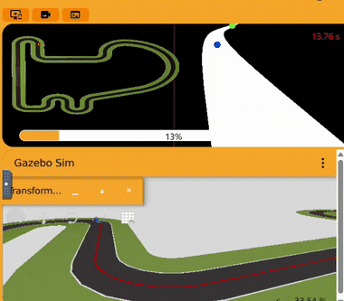 |

[CSV](results/p_v2_lap.csv) · [full video](results/p_v2_curve.mp4)

### v3: too fast, the car swerves

**Changes:** `V_MAX` 20 → 30, `V_MIN` 10 → 15.

**Result:** 26.10 s (**−21 %**), but the car swerves strongly (video):

* In the first tight corners (60–130 m) it goes up to **1.34 m** from the line.
  Over the lap it is more than 1 m away in 6 frames. `V_MIN = 15` is too fast
  for these corners.
* In the long left-hand curve (160–270 m) the speed follows a **saw-tooth**
  between 15 and 20 m/s, with 13 sudden brakes (more than 1 m/s in one frame).
  The steering `w` changes sign **16 times** (figure below).

**Diagnosis.** In the long curve the far error hovers around
`E_BRAKE = 0.25`. The sensitivity is `S = (30 − 15) / 0.25 = 60` m/s per unit
of error, so every small wobble of the error triggers a large brake. Since the
turn needed is `w = v·κ`, each speed change shifts the steering demand. The P
controller overshoots, the error moves again, and the cycle repeats.

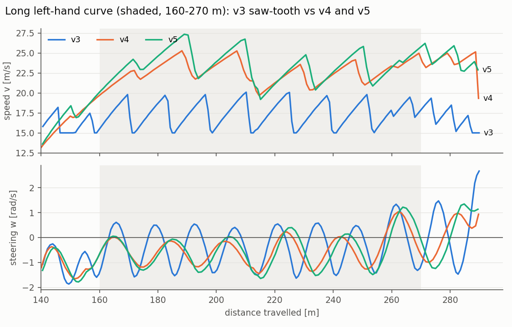

*Long left-hand curve. v3 (blue) brakes to `V_MIN` over and over and its
steering crosses zero on every cycle. v4 and v5 stay at about 19–27 m/s and
oscillate much less.*

**Decision:** make the speed policy less sensitive, and slow down in the tight
corners.

| Lap completed | Same section of the circuit |
|---|---|
| [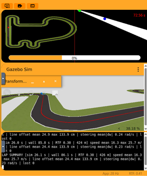](results/p_v3_lap_time.png) | 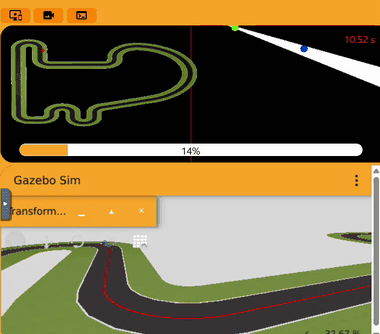 |

[CSV](results/p_v3_lap.csv) · [full video](results/p_v3_curve.mp4)

### v4: a calmer speed policy

**Changes:**

* `E_BRAKE` 0.25 → 0.5, which lowers `S` from 60 to 36.
* `V_MIN` 15 → 12, for the tight corners.
* `ACCEL` 0.4 → 0.3, for smoother ramps after each brake.
* `FAR_WEIGHT` 0.7 → 0.85, to look further ahead for smoother steering.

These four changes were made together to remove the swerving in a single run.
As a consequence, their individual effects cannot be separated.

**Result:** 26.00 s, a **tie** with v3, but a much cleaner lap. The sign
changes of `w` in the long curve drop from 16 to 8. The speed there stays
at about 20–25 m/s and never falls to `V_MIN`. The max distance to the line
drops from 1.34 to 1.00 m (0.76 m in run B).
The CSV shows where the time now goes: in **75 % of the frames the speed is
rising at the `ACCEL` limit**, and only 14 % are spent at `V_MIN`. The time is
lost accelerating out of the corners, not in them.
**Decision:** accelerate harder.

This is also the version that was run twice, on battery and plugged in
(section 3).

| Lap completed (run B, plugged in) | Same section of the circuit |
|---|---|
| [](results/p_v4_lap_time_laptopcharging.png) | 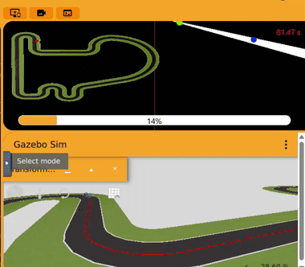 |

[CSV (run A)](results/p_v4_lap.csv) · [full video](results/p_v4_curve.mp4)

### v5: stronger acceleration

**Changes:** `ACCEL` 0.3 → 0.4 (6 → 8 m/s²) and `V_MAX` 30 → 34. The car never
actually reaches 34 m/s (max 29.6 m/s). However, a higher `V_MAX` raises the
target speed at every error: `S = (34 − 12) / 0.5 = 44`, so at `e_far = 0.1` the
target is 29.6 m/s instead of 26.4 m/s in v4.

**Result:** **24.65 s** (−1.35 s, −5 %), the fastest lap so far, with the line never
lost. The max distance to the line is 0.86 m, and `w` changes sign 9 times in
the long curve (8 in v4). The extra speed did not bring
back the v3 swerving.

| Lap completed | Same section of the circuit |
|---|---|
| [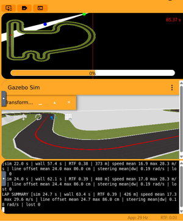](results/p_v5_lap_time.png) |  |

[CSV](results/p_v5_lap.csv) · [full video](results/p_v5_curve.mp4)

### Looking for the limit: v6 and v7

| Step | v1 → v2 | v2 → v3 | v3 → v4 | v4 → v5 |
|---|---|---|---|---|
| Change in simulated lap | −28.25 s | −6.80 s | −0.10 s | −1.35 s |

The first two steps saved 35 s. After that the gains became small: v3, v4 and
v5 are within 1.5 s of each other. Small, careful steps were no longer paying
off, so we decided to keep raising the speed **until the car failed**. That
would show where the limit of this controller is, and we could then step back
from it.

* **`V_MAX` 40, `ACCEL` 0.5** (an intermediate run, not in the table): the car
  still completed the lap.
* **v6: `V_MAX` 50, `ACCEL` 0.6.** This was chosen to force an extreme case,
  and it failed. The car reached 33.6 m/s and lost the line at about 121 m, in
  the corner at the end of a fast stretch (about 29 % of the lap). Once the line
  had left the camera's view, the search manoeuvre (`V_MIN / 2`, `W_LOST`) could
  not find it again. In the console, the counter of frames without the line
  keeps growing (101 → 141 → 181) while the car wanders off the track. From
  that point the run was useless.
* **v7: `V_MAX` 45, `ACCEL` 0.55**, halfway back from v6 towards the last
  setting that worked.

**Result of v7:** **23.50 s**, −1.15 s (−4.7 %) against v5. This is the fastest
lap, and the difference is well above the 0.5 s tie threshold. The mean speed
is 18.1 m/s and the max 33.5 m/s. But v7 is very close to the limit. In the
same corner where v6 left the track (~121 m), v7 arrived at 32.5 m/s, braked
to `V_MIN` and **lost the line for 5 frames (0.25 s)**. It found the line again
2.9 m away and completed the lap. In the rest of the lap its max distance to
the line is 1.25 m (in the long curve, at ~220 m).

Why that corner? Just before it, from about 100 to 115 m, the camera image
stalls in most laps (section 6). The line position stays the same for about
0.5 s while the car keeps accelerating. With the v6 and v7 settings, the car
leaves that stretch at more than 32 m/s and sees the corner late. This most
likely contributes to losing the line there.

| v6: off the track (`lost` keeps growing) | v7: lap completed (`lost 5`) |
|---|---|
| [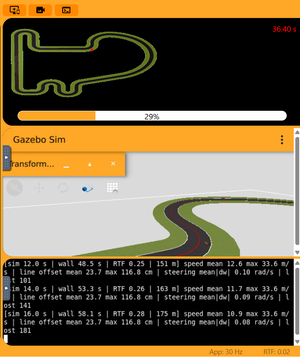](results/p_v6_car_derails.png) | [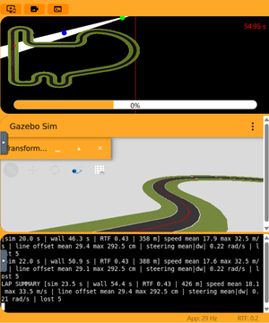](results/p_v7_lap_time.png) |

[CSV of v7](results/p_v7_lap.csv)

### Why we stopped at v7

v6 marks the limit, which is the corner at ~121 m. v7 sits just below it. It
is the fastest lap that was completed, but it already loses the line for a
moment in that corner, so there is no margin left for more speed with this
controller. v7 was kept as the final version because it is 1.15 s faster than
v5 and still completes the lap. v5 remains the safer setting (24.65 s, the line
never lost, max 0.86 m from it).

The remaining limit is structural. With only a proportional term, speed and
steering oscillate together in the curves (section 2.2). Damping that is the
job of the derivative term, so the next step is the PD controller,
not more P tuning.

---

## 5. Final result

The values in [`p_controller.py`](p_controller.py) are those of v7.

| | Lap |
|---|---|
| **v7, simulated time** | **23.50 s** |
| v7, Unibotics timer | 54.95 s (RTF 0.43) |

---

## 6. Limitations

* **One lap per version.** Differences below about 0.5 s are ties. The two v4
  runs show that the max distance to the line can vary by about 0.25 m from one
  run to another.
* **Pure P control.** There is a steady-state error in long curves and coupling
  between speed and steering (section 2.2).
* **Little margin in the final version.** v7 loses the line for 0.25 s at
  ~121 m, and v6 shows that a bit more speed there takes the car off the track.
  Once the car is off the track, the line-lost search cannot bring it back.
* **Image stalls.** In most laps there are short stretches (for example around
  100–115 m and in the last ~20 m) where the line position in the image stays
  exactly the same for 0.5–2.5 s while the speed keeps changing. The most likely
  cause is the simulator's rendering lagging behind on the test laptop. During
  those stretches the car drives on a slightly old image, which matters most
  just before the corner at ~121 m.
* **Tuned for the Simple Circuit only.**

---

## 7. Files

| File | Content |
|---|---|
| [`p_controller.py`](p_controller.py) | The controller (final values, v7) |
| [`baseline_slides.py`](baseline_slides.py) | The example from the slides, run at 6 m/s |
| [`results/p_vN_lap.csv`](results/) | Lap data of v1–v5 and v7 (one row per frame) |
| [`results/*_lap_time.png`](results/) | Timer and `LAP SUMMARY` at the end of each lap |
| [`results/p_v6_car_derails.png`](results/p_v6_car_derails.png) | v6 after leaving the track |
| [`results/*_curve.mp4`](results/) | Video of the same section of the circuit, baseline to v5 |
| [`results/gif/`](results/gif/) | The same videos as GIFs, for this page |
| [`results/thumbs/`](results/thumbs/) | Small copies of the screenshots shown on this page (click them for full size) |
| [`results/plots/`](results/plots/) | The figures and the diagram shown on this page |
