# Follow Line – PD controller

A **proportional-derivative (PD)** steering controller for the F1 car of the
[Follow Line exercise](https://jderobot.github.io/RoboticsAcademy/exercises/AutonomousCars/follow_line/)
of JdeRobot Robotics Academy. It was developed and tested on the **Unibotics**
online simulator (Simple Circuit), using the original Robotics Backend Docker
image. Only the controller code is ours; nothing in the environment was changed.

The PD controller is the P controller of this project plus a **derivative
term** on the steering. Perception, speed policy and telemetry are the same
code, so any difference between the two controllers comes from the derivative.

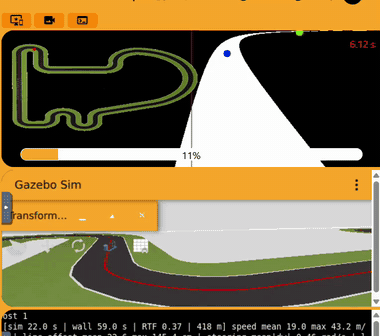

*The PD controller (v3) in a corner of the Simple Circuit, in Unibotics.*

| | |
|---|---|
| **Final version** | PD v6, [`pd_controller.py`](pd_controller.py) |
| **Starting point** | the final P controller (v7) + the derivative term (section 4.1) |
| **Lap time, simulated** (from the lap CSV) | **20.05 s** (P v7: 23.50 s, −15 %) |
| Lap time, Unibotics timer | 47.51 s (RTF 0.43 on the test laptop) |
| Line lost during the lap | never (P v7: 5 frames) |
| Distance to the line, mean / max | 0.34 m / 2.93 m (P v7: 0.29 m / 2.93 m) |
| Valid for | **one lap** from a standstill; the car leaves the track in the second lap (section 4.5) |

---

## 1. How to run

1. Start the original Robotics Backend:

   ```bash
   docker run --rm -it -p 6080-6090:6080-6090 -p 7163:7163 jderobot/robotics-backend:latest
   ```

2. Open <https://unibotics.org>, open **Follow Line**, keep the **Simple
   Circuit** and press **Connect**.
3. Paste the whole content of [`pd_controller.py`](pd_controller.py) into the
   editor and press **Play**. Press **Reset** before every new run.

The image panel shows the debug view: the red mask in white, the **far** point
(green), the **near** point (blue) and the image centre (red vertical line).
The console prints a report every 2 s of simulated time and a `LAP SUMMARY`
line after one lap.

**Getting the lap data.** Every run writes a CSV file inside the container. The
console prints its name when the run starts (`Logging this run to
/tmp/PD_HHMMSS.csv`). Copy it from a second terminal **before stopping the
container**, because `--rm` deletes the container together with its files:

```bash
docker ps
```

```bash
docker exec CONTAINER_NAME sh -c "ls /tmp/*.csv"
```

```bash
docker cp CONTAINER_NAME:/tmp/PD_103055.csv .
```

`CONTAINER_NAME` is the value in the `NAMES` column of `docker ps` (for
example `gracious_zhukovsky`). `PD_103055.csv` is an example file name.

---

## 2. How it works

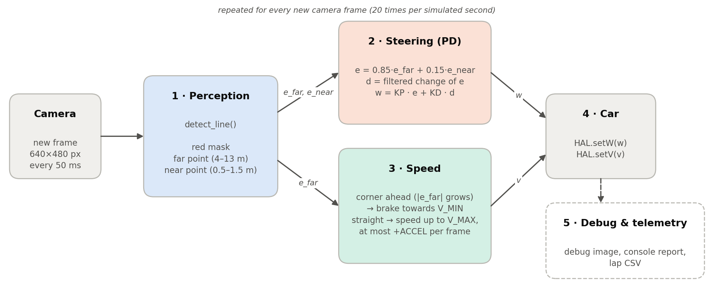

Every new camera frame goes through the same five steps:

1. **Perception** (2.1): find the red line and measure how far it is from the
   image centre at a far point and a near point. This gives the errors `e_far`
   and `e_near`.
2. **Steering** (2.2): the PD law turns the car towards the line,
   `w = KP · e + KD · d`, where `d` is how fast the error is changing.
3. **Speed** (2.3): brake when the far point shows that a corner is coming, and
   accelerate on the straights.
4. **Car**: the commands are sent with `HAL.setW(w)` and `HAL.setV(v)`.
5. **Debug and telemetry** (2.5): debug image in the GUI, console report and
   lap CSV. They only measure; they do not change how the car drives.

### 2.1 Perception (`detect_line`)

**What the camera sees.** The F1 camera is 640×480 px with a 90° horizontal
field of view (focal length 320 px). It sits about 0.10 m above the ground and
looks horizontally. The horizon is therefore at row 240, and a point on the
ground at distance *d* appears at row ≈ 240 + 33/*d*:

| image row | 243 | 248 | 256 | 273 | 306 | 400 |
|---|---|---|---|---|---|---|
| distance ahead | ~10 m | ~4 m | ~2 m | ~1 m | ~0.5 m | ~0.2 m |

The useful look-ahead is packed into the first ~15 rows under the horizon. The
big red triangle at the bottom of the image is only about 0.2 m in front of
the car. The example from the class slides follows the centroid of the whole
mask, which sits at row ~398, so it only reacts when the corner is already
under the car.

**What the code extracts:**

1. Only the ground half of the image (rows ≥ 242) is processed.
2. Red is detected in HSV with **two hue ranges** (0–10 and 165–180), because
   red wraps around H = 0 in OpenCV.
3. `top` is the first row that contains red, which is the farthest visible
   point of the line. Both bands are placed relative to `top`, not at fixed
   rows. They therefore keep working when the line leaves the image sideways
   in a corner.
4. **Far band**, rows `[top, top+6)`, about 4–13 m ahead: it sees the corner
   coming. **Near band**, rows `[top+20, top+60)`, about 0.5–1.5 m ahead: it
   keeps the car on the line.
5. The centroid of each band is computed with `cv2.moments`. Nothing indexes
   `contours[0]` as the slides' code does, so an empty mask cannot crash the
   program. If only one band sees the line, its value is used for both.
6. Each centroid *cx* becomes a normalised error `e = (320 − cx) / 320` in
   [−1, 1], positive when the line is on the left. Because f = 320 px,
   `e ≈ tan(angle to that point)`.

The camera is mounted 4 cm to the left of the car's centre. So even with the
car exactly on the line, the near point appears slightly to the right of the
image centre in the debug view. This is expected.

### 2.2 Steering: the PD law

```
e  = FAR_WEIGHT · e_far + (1 − FAR_WEIGHT) · e_near
Δe = e − e_previous                                   (change in one frame = 50 ms)
d  = D_ALPHA · Δe + (1 − D_ALPHA) · d_previous        (low-pass filter)
w  = KP · e + KD · d
```

* **P term.** `KP · e` turns the car towards the line, more the further away
  the line is. `KP = 4`: a line at the edge of the image (`e = 1`) gives
  4 rad/s of turn.
* **D term.** `KD · d` reacts to how fast the error is changing. It adds two
  things the P controller lacks:
  * **Damping.** When the car is already moving back towards the line, the
    error shrinks, `Δe` has the opposite sign, and the D term reduces the turn
    *before* the car overshoots. This targets the main problem of the P
    controller: in the long left-hand curve it weaves around the line with a
    period of about 0.85 s, and its steering changes sign 9–11 times.
  * **Anticipation.** At a corner entry the error starts growing fast. The D
    term reacts to that growth before the error itself is large, so the car
    starts turning earlier. The P controller lost the line exactly at such a
    moment (the corner at ~121 m).
* **Units.** The derivative is computed per camera frame, so `KD` multiplies
  the change of the error in one frame. Written as `w = KP · (e + (KD/KP) · Δe)`,
  the PD steers on the error *predicted* `KD/KP` frames ahead. With `KD = 6`
  and `KP = 4` that is 1.5 frames, about 75 ms.
* **Filter.** The line position is measured in whole pixels, so the raw change
  between frames is noisy. `D_ALPHA = 0.7` smooths it with a first-order
  low-pass filter (1 would mean no filter).
* **No derivative kick.** When the line reappears after being lost, the
  previous error is meaningless and the difference would be huge. The code
  restarts the derivative from the current error instead (`was_lost`).
* **What D does not fix.** In a curve of constant curvature κ taken at speed
  *v*, the car needs `w = v·κ`. Once the error stops changing, `d = 0` and only
  the P term is left, so the car still settles at `e ≈ v·κ / KP` and rides
  slightly on the outside of the line. Removing that offset is the job of an
  integral term.

### 2.3 Speed policy (`target_speed`)

```
v_target = V_MAX − (V_MAX − V_MIN) · min(1, |e_far| / E_BRAKE)
v        = min(v_target, v_previous + ACCEL)
```

* On a straight the far point is centred (`e_far ≈ 0`), so the car runs at
  `V_MAX`. When a corner is coming, the far point moves sideways **before** the
  car reaches it, so the car brakes in advance. It reaches `V_MIN` when
  `|e_far| ≥ E_BRAKE`.
* Braking is instant. Accelerating is limited to `ACCEL` per frame, which is
  `ACCEL / 0.05 s` in m/s² (0.8 → 16 m/s²).
* The **sensitivity** of this policy, `S = (V_MAX − V_MIN) / E_BRAKE`, is how
  many m/s the speed command changes per unit of far error. With a high `S`, a
  small wobble of the error produces a large change of speed.

### 2.4 Robustness details

* **Only new frames are processed.** `HAL.getImage()` returns the same image
  until the camera (20 Hz) sends a new one. The loop compares a sub-sampled
  copy with the previous image and sleeps 2 ms if nothing changed. The control
  law therefore runs exactly once per frame, which also makes the derivative a
  true per-frame difference, and the CPU is left to Gazebo.
* **Start.** The car does not move until it has seen the line, because the
  camera can take a moment to start after **Play**. The console shows
  `Waiting for the red line` in the meantime.
* **Line lost.** The car drops to `V_MIN / 2` and turns at `W_LOST` towards the
  side where the line was last seen. When the line reappears, the derivative
  restarts from zero (2.2).

### 2.5 Telemetry and lap CSV (`Telemetry` class)

Unibotics only shows the lap timer and the real-time factor (RTF). That is not
enough to compare versions fairly (section 3) or to understand *why* the car
behaves as it does. So the controller includes a measurement block that saves
the data of every frame. It does not influence how the car is driven.

* A console report every 40 frames (2 s of simulated time). The `LAP SUMMARY`
  line is printed once 425 m have been driven. The red line is 429 m long, and
  the car cuts the corners slightly. Logging stops there, so each CSV holds
  exactly one lap.
* One CSV row per frame:

| Column | Meaning |
|---|---|
| `sim_time` | Simulated time = frames × 0.05 s. The camera produces one frame every 50 ms of simulated time |
| `dist` | Distance travelled = Σ v · 0.05 s. The F1 model applies the commanded speed directly |
| `v`, `w` | Speed and steering commands sent to the car |
| `line_offset` | Distance [m] between the car's centre line and the red line. It is estimated from the camera geometry at rows 395–405 (≈ 0.2 m ahead) and corrected for the 4 cm camera offset |
| `lost` | 1 if no red was visible in the image |

The `LAP SUMMARY` gives the same values aggregated over the lap. It also
reports the wall-clock time and the RTF, and the mean |Δw| between frames, which
measures how smooth the steering is:

```
LAP SUMMARY [sim … s | wall … s | RTF … | 426 m] speed mean … max … m/s |
line offset mean … max … cm | steering mean|dw| … rad/s | lost …
```

`line_offset` is an estimate, because it also contains a small part of the
heading error. In an offline replica of the circuit (a Python model of the
track, car and camera, used before testing in Unibotics), where the true
distance is known, it was within a few centimetres of it (mean 20.4 vs
19.2 cm, max 99.4 vs 96.4 cm).

### 2.6 Parameters (final version, PD v6)

| Parameter | Value | Meaning |
|---|---|---|
| `KP` | 4.0 | proportional gain [rad/s per unit of error] |
| `KD` | 6.0 | derivative gain [rad/s per unit of error change per frame] |
| `D_ALPHA` | 0.7 | low-pass filter on the derivative (1 = no filter) |
| `V_MAX` | 80.0 m/s | speed with the far point centred (never reached; it sets the target speed at every far error) |
| `V_MIN` | 12.0 m/s | speed in the tightest corners |
| `E_BRAKE` | 0.5 | far error at which the speed reaches `V_MIN` (line ≈ 27° off-centre) |
| `ACCEL` | 0.8 m/s per frame | maximum speed increase per frame (16 m/s²); braking is instant |
| `FAR_WEIGHT` | 0.85 | share of the far point in the steering error |
| `W_LOST` | 1.5 rad/s | search turn rate if the line is lost |

The telemetry constants (`TELEMETRY`, `REPORT_EVERY`, `CSV_LOG`, `RUN_NAME`,
`LAP_LENGTH`, …) only change what is printed and saved.

---

## 3. Measuring the lap: simulated time, not the timer

The Unibotics timer counts **wall-clock** time (`datetime.now()` in the
exercise's `lap.py`). The car moves in **simulated** time. The two are related
by the RTF = simulated time / real time. When the computer is slower, Gazebo
simulates fewer seconds per real second. The same lap then takes longer on the
timer, even though the car does exactly the same thing.

This was measured during the P controller tests. The same configuration was
run twice on the same laptop: on battery after waking from sleep, the timer
showed 97.36 s (RTF 0.27); plugged in, 61.00 s (RTF 0.43). The simulated lap
was 26.0 s both times.

**So all comparisons use the simulated lap time from the CSV:** the
`sim_time` of the first row where `dist` reaches 425 m. The `LAP SUMMARY` gives
the same value, rounded. The timer is still reported, always together with its
RTF. Each version is driven once, and the 425 m end point depends slightly on
how the car cuts the corners. So **differences below about 0.5 s are treated as
ties**.

---

## 4. Tests

### 4.1 Starting point: P v7 + the derivative term

The first PD version does not start from scratch. It takes **all the values of
the final P controller (v7)** and adds the derivative term:

| Parameter | PD v1 | Where it comes from |
|---|---|---|
| `KP` | 4.0 | Same in all 7 P versions; the steering on the straights was always smooth |
| `KD` | **6.0** | New: from the offline tuning, checked on the P lap data (below) |
| `D_ALPHA` | **0.7** | New: filter of the derivative |
| `V_MAX` | 45 | P v7 |
| `V_MIN` | 12 | P v4–v7. With 15, the P went up to 1.34 m from the line in the tight corners |
| `E_BRAKE` | 0.5 | P v4–v7. With 0.25, the speed followed a saw-tooth in the long curve |
| `ACCEL` | 0.55 | P v7 |
| `FAR_WEIGHT` | 0.85 | P v4–v7 |

The reasons for this choice:

* **The speed tuning carries over.** Perception and speed policy are the same
  code in both controllers; only the steering law changes. What the P tests
  showed about speeds is therefore valid here.
* **The offline values are far too conservative for Unibotics.** The code
  first carried the values tuned in the offline replica (`V_MAX` 18, `V_MIN` 8,
  `E_BRAKE` 0.7, `ACCEL` 1.0). For the P controller the same replica suggested
  `V_MAX = 16`, while in Unibotics the P completed laps at `V_MAX = 45`.
  Starting from the offline values would mean repeating most of the P tests
  (v1 to v5), which were needed to climb from `V_MAX = 12` to 34.
* **One change at a time.** The only difference from P v7 is the derivative
  term, so the first lap already measures what the derivative adds. In the P
  tests, changing four parameters at once (P v4) made it impossible to tell
  their effects apart.
* **`KD = 6` has the right size.** Applying the derivative, with `KD = 6` and
  `D_ALPHA = 0.7`, to the errors logged in the P v5 and v7 laps gives an
  estimate of how large the D term would be. This is not a simulation: with the
  derivative active the trajectory would change. It does show the order of
  magnitude:

| Where (P v5 / P v7 laps) | P term | D term with `KD = 6` |
|---|---|---|
| Long left-hand curve (160–270 m), RMS | 0.87 / 0.99 rad/s | 0.32 / 0.42 rad/s |
| Corner entry at ~121 m, max | – | 1.8 / 2.3 rad/s |

  In the long curve the D term would be about 35–45 % of the P term. At the
  observed weaving period (about 17 frames, 0.85 s) it gives a phase lead of
  about 25–30°. That is enough to damp the oscillation without dominating the
  steering. At the corner where the P v7 lost the line, it would add about
  2 rad/s of turn exactly when the error starts growing. A much larger `KD`
  would amplify pixel noise and the jumps of the image after a stall (section 6).

### 4.2 What PD v1 has to beat

| | Sim lap | Line lost | Max distance to the line | Sign changes of `w` in the long curve |
|---|---|---|---|---|
| P v7 (fastest P) | 23.50 s | 5 frames (0.25 s) | 2.93 m | 11 |
| P v5 (safest fast P) | 24.65 s | never | 0.86 m | 9 |

**Expected result.** The lap time of PD v1 will probably be close to P v7. The
derivative does not change how fast the car accelerates, and in the P laps the
speed was rising at the `ACCEL` limit in about 75 % of the frames. The gain
should appear as **margin**: no frames without the line, a smaller maximum
distance to the line, and fewer sign changes of `w`.

### 4.3 Plan for the next versions

This plan was written before running PD v1. The decision taken after PD v1
is explained with its results (section 4.4).

| If PD v1… | Then PD v2… |
|---|---|
| never loses the line and weaves less than P v7 | uses the P v6 speeds (`V_MAX` 50, `ACCEL` 0.6), which took the P off the track: does the derivative push the limit further? |
| weaves more, or `w` jumps when leaving the corners | `KD = 4`, or a stronger filter (`D_ALPHA = 0.5`): the derivative is amplifying noise |
| behaves almost exactly like P v7 | `KD = 9`: the derivative is too weak to matter |

Later, as a separate experiment, `FAR_WEIGHT` can be lowered to 0.7: the
derivative already gives anticipation, so more weight can go to the near point
to keep the car closer to the line.

### 4.4 Iterations

**Method.** Each version is driven for one lap on the Simple Circuit, with
**Reset** before each run. For every lap we keep the timer screenshot with the
`LAP SUMMARY`, a video of the same section of the circuit, and the lap CSV
(PD v1 to v4; PD v6 has no video, and PD v5 only has the screenshot of the
moment it left the track).
Each new set of parameters is chosen from the data of the previous lap.

| Version | KD | D_ALPHA | V_MAX | ACCEL | FAR_W. | Sim lap | Timer (RTF) | Mean speed | Dist. to line mean / max | Lost |
|---|---|---|---|---|---|---|---|---|---|---|
| PD v1 | 6.0 | 0.7 | 45 | 0.55 | 0.85 | 21.85 s | 56.51 s (0.39) | 19.5 m/s | 0.23 / 1.45 m | 0 |
| PD v2 | **10.0** | 0.7 | 45 | 0.55 | 0.85 | 22.25 s | 61.84 s (0.37) | 19.1 m/s | 0.22 / 1.45 m | 1 |
| PD v3 | **6.0** | 0.7 | **55** | **0.65** | 0.85 | 21.05 s | 55.59 s (0.27) | 20.2 m/s | 0.27 / 1.45 m | 0 |
| PD v4 | 6.0 | 0.7 | **75** | **0.75** | 0.85 | 20.55 s | 50.83 s (0.42) | 20.7 m/s | 0.31 / 2.16 m | 2 |
| PD v5 | 6.0 | 0.7 | **85** | **0.8** | 0.85 | left the track at ~292 m | – | – | – | – |
| **PD v6** | 6.0 | 0.7 | **80** | 0.8 | 0.85 | **20.05 s** | 47.51 s (0.43) | 21.2 m/s | 0.34 / 2.93 m | 0 |

`KP = 4.0`, `V_MIN = 12` and `E_BRAKE = 0.5` in all PD versions. The timer comes
from the screenshot and the RTF from the `LAP SUMMARY`; the lap times compared
are the simulated ones from the CSVs, as always (section 3). Bold values changed
from the previous version (PD v3 is compared with PD v1).

#### PD v1: the derivative alone saves 1.65 s

PD v1 has exactly the same parameters as P v7, plus the derivative term:

| | P v7 | **PD v1** |
|---|---|---|
| Simulated lap | 23.50 s | **21.85 s** (−1.65 s, −7 %) |
| Line lost | 5 frames at ~121 m | **never** |
| Distance to the line, mean / max | 0.29 / 2.93 m | **0.23 / 1.45 m** |
| Long curve (160–270 m): sign changes of `w` | 11 | **1** |
| Long curve: speed min / mean | 12.0 / 23.9 m/s | **21.1 / 30.6 m/s** |
| Long curve: time | 4.60 s | **3.60 s** |
| Corner at ~121 m: time from 115 to 130 m | 1.25 s | **0.90 s** |

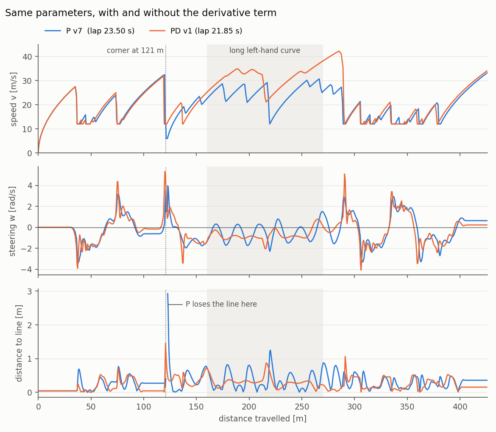

*Speed, steering and distance to the line along the lap. Blue: P v7. Orange:
PD v1. Same parameters; the only difference is the derivative term.*

The result is better than expected (section 4.2), and the data shows why:

* **The weaving in the long curve disappears.** The steering of P v7 changes
  sign 11 times in that curve; with the derivative, only once. The steering
  changes there are half as large (mean |Δw| 0.26 → 0.14 rad/s).
* **Better steering makes the same speed policy faster.** The speed depends
  on `|e_far|`. With the weaving gone, `e_far` stays small and steady, so the
  policy no longer brakes in the curve. The speed there stays between 21 and
  38 m/s instead of dropping to 12 m/s. This section alone saves 1.0 s, about
  60 % of the total gain.
* **The corner at ~121 m is now clean.** P v7 lost the line there. PD v1
  turned harder as soon as the error started growing (up to 5.3 rad/s against
  4.0) and kept the line, at most 1.45 m away.
* **The cost** is sharper steering at corner entries: over the whole lap the
  mean |Δw| rises from 0.21 to 0.26 rad/s.
* **Acceleration is still the main limit.** The speed is rising at the
  `ACCEL` limit in 74 % of the frames, as in the P laps.

**Decision: raise `KD` to 10 before pushing the speed.** PD v1 never loses the
line and weaves much less than P v7, so the plan of section 4.3 was to go
straight to the P v6 speeds. The PD v1 data suggests strengthening the
derivative first, without changing anything else:

* **Lowering `KD` is already known to be worse.** `KD = 0` is P v7 (23.50 s,
  weaving, line lost) and `KD = 6` is PD v1 (21.85 s). A value in between
  would only move back towards the P behaviour.
* **The remaining errors are where the derivative acts.** In PD v1 the
  distance to the line goes above 0.6 m only 5 times (14 times in P v7). The
  two largest are at the entries of the corners at 121 m (1.45 m) and 291 m
  (1.06 m), right after the two fastest stretches of the lap (32 and 42 m/s).
  There the error grows very fast, which is exactly what the D term reacts to.
  A larger `KD` makes the car turn earlier at those entries.
* **Those are the corners the speed increase will hit hardest.** P v6 left the
  track at 121 m. With `V_MAX` 50 and `ACCEL` 0.6 the car will reach both
  corners even faster, so that is where the extra margin is needed.
* **There is still room before the derivative makes the steering nervous.** In
  PD v1 the steering zigzags (two consecutive changes of more than 0.3 rad/s in
  opposite directions) in only 5 of 437 frames, so `KD` can be raised
  clearly (to 10, +67 %) to see its effect.

**PD v2 = PD v1 with `KD = 10`.** How it will be judged:

* **Lap time:** probably a tie with PD v1 (±0.5 s). `KD` does not change the
  acceleration, which still limits 74 % of the lap.
* **Success:** a smaller distance to the line at 121 m and 291 m, no lost
  frames, and no new weaving in the long curve.
* **`KD` too high:** the zigzag frames and the `steering mean|dw|` of the
  `LAP SUMMARY` rise clearly, or the steering kicks after an image stall. In
  that case `KD = 6` is kept.
* **Next step (PD v3):** the P v6 speeds (`V_MAX` 50, `ACCEL` 0.6) with
  whichever `KD` left more margin.

| Lap completed | Same section of the circuit |
|---|---|
| [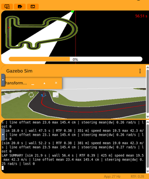](results/pd_v1_lap_time.png) | 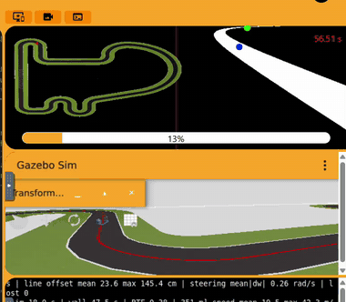 |

[CSV](results/pd_v1_lap.csv) · [full video](results/pd_v1_curve.mp4)

#### PD v2: `KD = 10` is too much

PD v2 is PD v1 with `KD` raised from 6 to 10; nothing else changes. Together
with P v7 (which is the same controller with `KD = 0`), it shows the effect of
the derivative gain alone:

| | KD 0 (P v7) | **KD 6 (PD v1)** | KD 10 (PD v2) |
|---|---|---|---|
| Simulated lap | 23.50 s | **21.85 s** | 22.25 s |
| Line lost | 5 frames at 121 m | **never** | 1 frame at 290 m |
| Distance to the line, mean / max | 0.29 / 2.92 m | 0.23 / 1.45 m | 0.22 / 1.45 m |
| Max distance at the corner at 121 m | 2.92 m | 1.45 m | **0.54 m** |
| Max distance at the corner at 291 m | 0.60 m | 1.06 m | 1.45 m |
| Peaks above 0.6 m from the line | 14 | 5 | 3 |
| Steering zigzag frames | 1 | 5 | **24** |
| Mean steering change per frame | 0.21 rad/s | 0.26 rad/s | **0.46 rad/s** |
| Maximum steering | 3.97 rad/s | 5.33 rad/s | 7.12 rad/s |

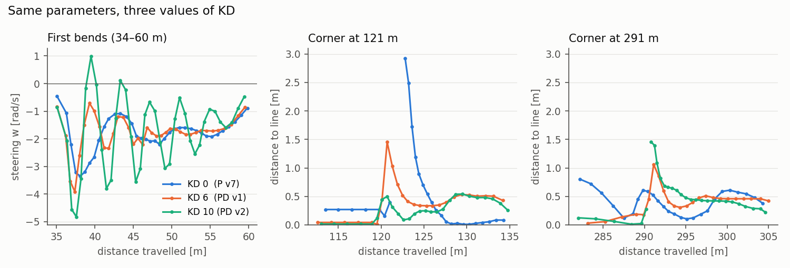

*Left: steering in the first bends. Centre and right: distance to the line at
the two critical corners. Blue: KD 0 (P v7). Orange: KD 6 (PD v1). Green:
KD 10 (PD v2).*

* **The anticipation works as expected.** At the corner at 121 m the stronger
  derivative turns the car in earlier: the maximum distance to the line drops
  from 1.45 m to 0.54 m (2.92 m without derivative).
* **But the steering becomes nervous.** The derivative now reacts so strongly
  to its own corrections that the steering zigzags in the slow bends, with a
  period of about 0.3 s (left figure). The zigzag frames go from 5 to 24, and
  the mean steering change per frame almost doubles (0.26 → 0.46 rad/s).
* **At the fastest corner entry it overreacts.** The car reaches the corner at
  291 m at 43 m/s. The steering jumps to 7.1 rad/s, the largest value of all the
  laps, and the line leaves the image for one frame. The car then drops to the
  search speed (6 m/s) and has to accelerate again. Most of the extra time
  (0.25 s of the 0.40 s) is lost in that section.
* **The result** is 0.40 s slower than PD v1. That is within the ±0.5 s tie
  margin, but with a lost frame and much more nervous steering, so PD v1 is
  better on every margin criterion.

#### Why we continue with `KD = 6`

The three laps above differ only in `KD`, and they show the classic trade-off
of the derivative term:

| `KD` | Behaviour | Lap |
|---|---|---|
| 0 (P v7) | **Too little derivative.** Weaves in the long curve and reacts late at corner entries; loses the line at 121 m | 23.50 s |
| **6 (PD v1)** | **Balanced.** The weaving is gone, the corner at 121 m is taken without losing the line, and the steering stays calm | **21.85 s** |
| 10 (PD v2) | **Too much derivative.** Even better anticipation at 121 m, but the derivative reacts to its own corrections: zigzag in the slow bends and an overreaction at 291 m that loses the line | 22.25 s |

`KD = 6` is kept for four reasons:

1. **It gives the fastest lap** of the three: 21.85 s against 22.25 s with
   `KD = 10` and 23.50 s without derivative.
2. **It is the only one that never loses the line.** With `KD = 0` the line is
   lost at 121 m (5 frames), and with `KD = 10` at 291 m (1 frame).
3. **`KD = 10` meets the "too high" criteria set before the run.** The rule
   written for PD v2 was that `KD` is too high if the zigzag frames and the mean
   steering change rise clearly. Both did: zigzag frames from 5 to 24, and mean
   steering change from 0.26 to 0.46 rad/s.
4. **Fine-tuning `KD` would gain little time now.** With `KD = 6` the car is
   already limited by acceleration: the speed is rising at the `ACCEL` limit in
   74 % of the frames, and `KD` does not change that. The real time gain is in
   the speeds, so the next run raises them instead of testing more `KD` values.

The only advantage of `KD = 10` is the smaller distance to the line at the
corner at 121 m. That corner is exactly where P v6 left the track, so it
matters once the speed goes up. A value between 6 and 10 (about 8) has not
been tested yet. It is kept as the fallback if that corner becomes the problem
at higher speed.

**Next: PD v3 = PD v1 (`KD = 6`) with higher speeds.** The plan was the P v6
speeds (`V_MAX` 50, `ACCEL` 0.6). The run went one step further, to 55 and
0.65. If the car struggles at the corner at 121 m, the next step is `KD = 8`
at those speeds.

| Lap completed | Same section of the circuit |
|---|---|
| [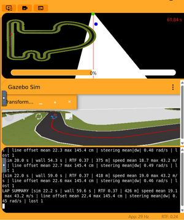](results/pd_v2_lap_time.png) | 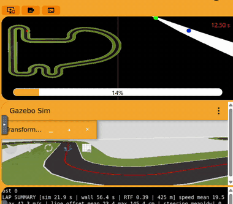 |

[CSV](results/pd_v2_lap.csv) · [full video](results/pd_v2_curve.mp4)

#### PD v3: faster than the speeds that took the P off the track

PD v3 keeps `KD = 6` and raises the speeds above those of P v6, the P version
that left the track: `V_MAX` 45 → 55 and `ACCEL` 0.55 → 0.65 (11 → 13 m/s²).
P v6 used 50 and 0.6.

| | P v7 | PD v1 | **PD v3** |
|---|---|---|---|
| `V_MAX` / `ACCEL` | 45 / 0.55 | 45 / 0.55 | **55 / 0.65** |
| Simulated lap | 23.50 s | 21.85 s | **21.05 s** |
| Line lost | 5 frames | never | **never** |
| Distance to the line, mean / max | 0.29 / 2.92 m | 0.23 / 1.45 m | 0.27 / 1.45 m |
| Speed entering the corner at 121 m | 32.5 m/s | 31.9 m/s | **34.3 m/s** |
| Max distance at the corner at 121 m | 2.92 m (line lost) | 1.45 m | **1.25 m** |
| Max speed | 33.5 m/s | 42.3 m/s | 45.6 m/s |
| Steering zigzag frames | 1 | 5 | 9 |
| Frames at the `ACCEL` limit | 77 % | 74 % | 79 % |

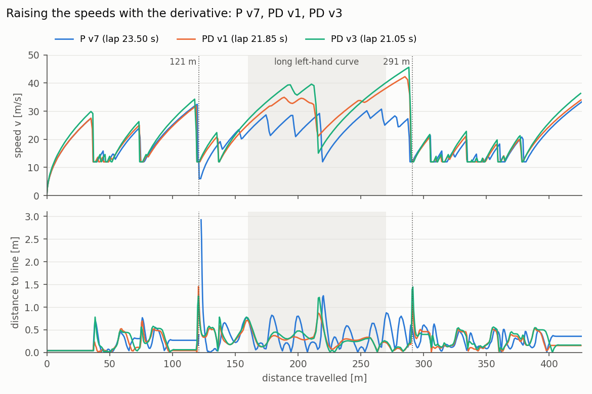

*Speed and distance to the line along the lap. Blue: P v7. Orange: PD v1.
Green: PD v3. Dotted lines: the corners at 121 m and 291 m.*

Where the 0.80 s against PD v1 are gained:

| Section of the lap | PD v1 | PD v3 | Difference |
|---|---|---|---|
| 0–115 m (start and first bends) | 7.05 s | 6.65 s | **−0.40 s** |
| 115–130 m (corner at 121 m) | 0.90 s | 0.85 s | −0.05 s |
| 130–160 m | 1.60 s | 1.55 s | −0.05 s |
| 160–270 m (long left-hand curve) | 3.60 s | 3.60 s | 0.00 s |
| 270–425 m (chicanes and final straight) | 8.70 s | 8.40 s | **−0.30 s** |

* **The derivative pushes the limit further.** P v6 lost the line at the
  corner at 121 m after reaching 33.6 m/s, and could not find it again. PD v3
  enters that corner even faster (34.3 m/s) and keeps the line, at most 1.25 m
  away (less than PD v1).
* **The time comes from accelerating harder.** The straights (0–115 m and
  270–425 m) give 0.70 s of the 0.80 s. The speed is rising at the `ACCEL`
  limit in 79 % of the frames, so acceleration is still the main limit.
* **The long curve gains nothing.** The car reaches 40 m/s there and has to
  brake hard at about 214 m, down to 15 m/s and 1.21 m from the line. With
  `V_MAX = 55` the speed policy is very sensitive: `S = (55 − 12) / 0.5 = 86` m/s
  per unit of error. P v3's saw-tooth started at `S = 60`. The curve shows the
  first signs of the same effect: the steering changes sign 3 times instead
  of 1.
* **The margin is used up evenly.** The largest distances to the line are
  1.25 m (121 m), 1.21 m (217 m) and 1.45 m (292 m), with no lost frames. The
  steering zigzags a little more (9 frames against 5).

**Decision.** PD v3 is the best PD so far: 21.05 s, 0.80 s faster than PD v1
and 2.45 s faster than P v7, and it becomes the reference for the next run.
**PD v4 changes only `ACCEL` (0.65 → 0.75)**, because
acceleration is still the main limit. `V_MAX` is kept at 55: the car never
reaches it, and a higher value would only make the speed policy even more
sensitive in the long curve. If PD v4 loses the line, or goes clearly beyond
1.5 m from it at the three critical corners, the next step is `KD = 8`, or
going back to the PD v3 values.

| Lap completed | Same section of the circuit |
|---|---|
| [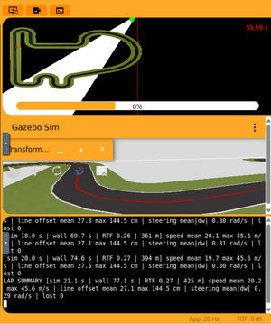](results/pd_v3_lap_time.png) |  |

[CSV](results/pd_v3_lap.csv) · [full video](results/pd_v3_curve.mp4)

#### PD v4: the fastest lap, at the limit again

The plan was to change only `ACCEL`. The run raised `ACCEL` from 0.65 to 0.75
(13 → 15 m/s²) **and** `V_MAX` from 55 to 75, so the effect of each one cannot
be separated. The car never gets near 75 m/s (its maximum is 48.0 m/s). What
the higher `V_MAX` changes is the target speed at every far error: the
sensitivity of the speed policy grows to `S = (75 − 12) / 0.5 = 126` m/s per
unit of error (86 in PD v3).

| | PD v3 | **PD v4** |
|---|---|---|
| `V_MAX` / `ACCEL` | 55 / 0.65 | **75 / 0.75** |
| Simulated lap | 21.05 s | **20.55 s** (−0.50 s) |
| Unibotics timer (RTF) | 55.59 s (0.27) | 50.83 s (0.42) |
| Line lost | never | 2 frames (0.10 s) at 293 m |
| Distance to the line, mean / max | 0.27 / 1.45 m | 0.31 / 2.16 m |
| Max speed | 45.6 m/s | 48.0 m/s |
| Corner at 37 m: entry speed / max distance to the line | 29.9 m/s / 0.78 m | 32.2 m/s / 1.21 m |
| Corner at 121 m | 34.3 m/s / 1.25 m | 37.0 m/s / 1.29 m |
| Long curve, braking at ~216 m | 39.6 m/s / 1.21 m | 45.5 m/s / 1.56 m |
| Corner at 291 m | 45.6 m/s / 1.45 m | 48.0 m/s / 2.16 m (line lost) |

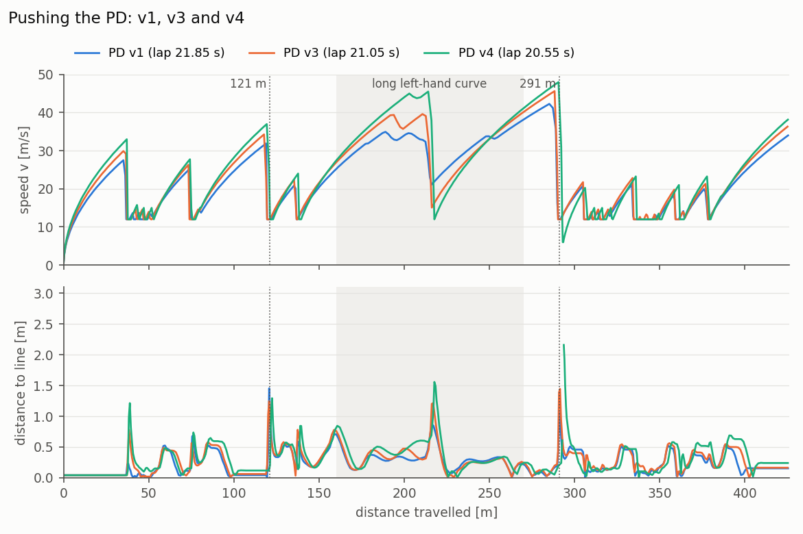

*Speed and distance to the line along the lap. Blue: PD v1. Orange: PD v3.
Green: PD v4.*

| Section of the lap | PD v3 | PD v4 | Difference |
|---|---|---|---|
| 0–115 m (start and first bends) | 6.65 s | 6.30 s | **−0.35 s** |
| 115–130 m (corner at 121 m) | 0.85 s | 0.80 s | −0.05 s |
| 130–160 m | 1.55 s | 1.55 s | 0.00 s |
| 160–270 m (long left-hand curve) | 3.60 s | 3.50 s | −0.10 s |
| 270–425 m (chicanes and final straight) | 8.40 s | 8.40 s | 0.00 s |

* **Faster on the straights.** Most of the gain comes from the first 115 m
  (−0.35 s), where the harder acceleration pays off.
* **Every critical corner is entered faster, and the car ends further from the
  line at all four of them.** At the corner at 291 m, entered at 48 m/s, the
  line leaves the image for 2 frames. The car drops to the search speed
  (6 m/s) and loses there what it had gained: the last section takes the same
  time as in PD v3.
* **In the long curve the car now brakes all the way to `V_MIN`** (12 m/s at
  about 216 m, 1.56 m from the line). The very sensitive speed policy
  (`S = 126`) makes it arrive faster and brake harder.
* **The gain (0.50 s) is at the edge of the ±0.5 s tie margin.** The timer
  shows a larger difference (55.59 s → 50.83 s), but most of it comes from the
  different RTF of the two runs (0.27 against 0.42), not from the car.

**Decision.** PD v4 is the fastest PD lap so far: 20.55 s, 2.95 s (−13 %)
faster than P v7. But it already loses the line for a moment at the fastest
corner. As with the P controller (P v6), the speeds were pushed once more to
find where the PD fails (PD v5), and then stepped back (PD v6).

| Lap completed |
|---|
| [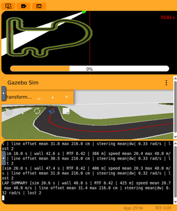](results/pd_v4_lap_time.png) |

[CSV](results/pd_v4_lap.csv)

#### PD v5 and v6: the limit of the PD, and the final version

As with the P controller, the speeds were pushed until the car failed, and
then stepped back:

* **PD v5: `V_MAX` 85, `ACCEL` 0.8.** The car reached 50.1 m/s and lost the
  line at the corner at 291 m, and it never found it again. The console in the
  screenshot below shows where: the counter of frames without the line grows
  by 40 every 2 s (all frames), while the distance grows by only 12 m, the
  search speed of 6 m/s. Counting back, the line was lost at about 12.4 s of
  simulated time and 292 m.
| PD v5: off the track |
|---|
| [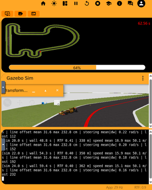](results/pd_v5_derail.png) |

* **PD v6: `V_MAX` 80, `ACCEL` 0.8.** One step back on `V_MAX`. The car
  completed the lap in **20.05 s**, 0.50 s faster than PD v4 and 3.45 s
  (−15 %) faster than P v7, without losing the line.

Compared with PD v4 (`V_MAX` 75 → 80, `ACCEL` 0.75 → 0.8):

| | PD v4 | **PD v6** |
|---|---|---|
| Simulated lap | 20.55 s | **20.05 s** |
| Unibotics timer (RTF) | 50.83 s (0.42) | 47.51 s (0.43) |
| Line lost | 2 frames at 293 m | **never** |
| Distance to the line, mean / max | 0.31 / 2.16 m | 0.34 / 2.93 m |
| Max speed | 48.0 m/s | 49.6 m/s |
| Corner at 37 m: entry speed / max distance to the line | 32.2 m/s / 1.21 m | 33.6 m/s / 0.59 m |
| Corner at 76 m | 27.8 m/s / 0.74 m | 28.8 m/s / 1.65 m |
| Corner at 121 m | 37.0 m/s / 1.29 m | 37.6 m/s / 2.93 m |
| Long curve, braking at ~216 m | 45.5 m/s / 1.56 m | 46.1 m/s / 1.73 m |
| Corner at 291 m | 48.0 m/s / 2.16 m (line lost) | 49.6 m/s / 2.05 m |

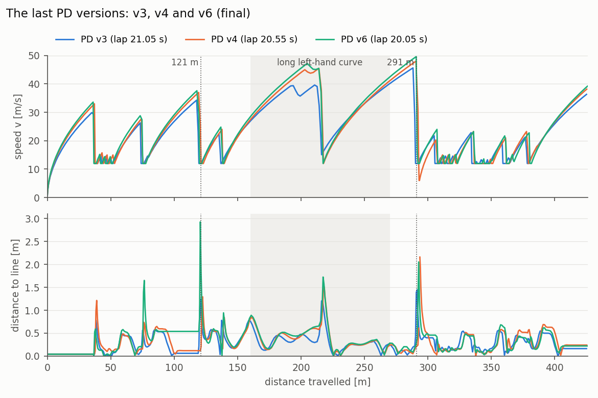

*Speed and distance to the line along the lap. Blue: PD v3. Orange: PD v4.
Green: PD v6 (final).*

| Section of the lap | PD v4 | PD v6 | Difference |
|---|---|---|---|
| 0–115 m (start and first bends) | 6.30 s | 6.20 s | −0.10 s |
| 115–130 m (corner at 121 m) | 0.80 s | 0.80 s | 0.00 s |
| 130–160 m | 1.55 s | 1.50 s | −0.05 s |
| 160–270 m (long left-hand curve) | 3.50 s | 3.45 s | −0.05 s |
| 270–425 m (chicanes and final straight) | 8.40 s | 8.10 s | **−0.30 s** |

* **Most of the gain is in the last section.** PD v4 lost the line at the
  corner at 291 m and had to accelerate again from 6 m/s; PD v6 kept the line
  there. The slightly higher speeds give the other 0.20 s.
* **There is no margin left.** PD v6 never loses the line, but at the corner
  at 121 m it ends 2.93 m away from it, the same distance at which P v7 lost
  the line at that corner. Just before that corner, from about 88 m to 118 m,
  the camera image stalls for about 1 s: the line position does not change
  while the car accelerates to 37.6 m/s, so it sees the corner late. The
  corners at 76 m and 291 m also go above 1.6 m. The corner at 291 m is the
  critical one at these speeds: PD v4 lost the line there for 2 frames, and
  PD v5 left the track there.
* **At the limit, single runs differ.** PD v4 lost the line at 291 m, and
  PD v6, slightly faster, did not. With one lap per version, PD v6 shows that
  this setting *can* complete the lap, not that it always will.

**Final version: PD v6.** It is the fastest PD lap that was completed, and
PD v5 shows that a little more speed takes the car off the track. The values
in [`pd_controller.py`](pd_controller.py) are those of PD v6. PD v3 remains the
safest of the fast settings (21.05 s, at most 1.45 m from the line).

| Lap completed |
|---|
| [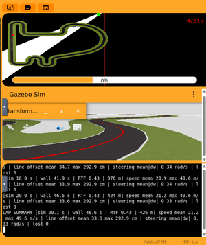](results/pd_v6_lap_time.png) |

[CSV](results/pd_v6_lap.csv)

### 4.5 Optimised for one lap, not for several

The parameters were tuned for the fastest **single lap** starting from a
standstill, which is what the exercise measures. They are not valid for
consecutive laps: with PD v6 the car **leaves the track in the second lap**,
right after the long straight that joins the end of one lap with the start of
the next.

The reason is the speed at which the car reaches the first corner:

* **First lap:** the car starts from 0 m/s, so after the 36 m of the start
  straight it reaches the first corner at 33.6 m/s.
* **Second lap:** the first lap ends on the long final straight at 39.2 m/s,
  and the car is still accelerating. It crosses the start line at that speed
  and keeps accelerating at the `ACCEL` limit (16 m/s²) along the start
  straight. It reaches the first corner at an estimated **~52 m/s**, more than
  50 % faster than in the first lap. The speed policy only brakes when the far
  point sees the corner, 4–13 m ahead, which is far too late from that speed.

The ~52 m/s is an estimate: it is computed from the logged speed at the end of
the lap with the same acceleration limit. It could not be measured, because
logging stops after the first lap. Where the car fails, however, was observed:

| PD v6 in its second lap |
|---|
| [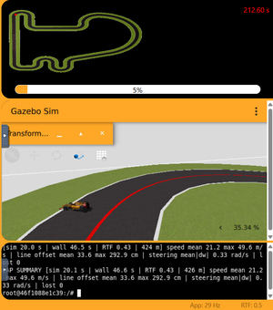](results/pd_v6_second_lap_derail.png) |

*PD v6 after completing its first lap. In the second lap it has left the
track at the first corner after the start (red dot at the top left of the map,
5 % of the lap). The console still shows the `LAP SUMMARY` of the first lap.*

Making the controller safe for several laps would need, for example, a lower
`V_MAX`, or a speed limit that depends on how far ahead the corner can be seen
(the braking distance grows with the square of the speed). That was not the
goal of this exercise and was not tested.

---

## 5. Final result

The values in [`pd_controller.py`](pd_controller.py) are those of PD v6.

| | Lap (simulated time) |
|---|---|
| **PD v6 (final)** | **20.05 s** |
| PD v1 (same parameters as the best P) | 21.85 s |
| P v7 (best P controller) | 23.50 s |

Over one lap the PD controller is **3.45 s (15 %) faster** than the best P
controller, and it does not lose the line. On the Unibotics timer the lap took
47.51 s, at an RTF of 0.43. The setting is valid for one lap from a standstill
(section 4.5).

---

## 6. Limitations

* **Steady-state error.** In a long curve of constant curvature the derivative
  is zero, so the car keeps the same small offset to the outside of the line
  as the P controller (2.2).
* **Image stalls.** In most laps there are short stretches where the camera
  image does not change for 0.5–2.5 s (for example before the corner at 121 m
  in PD v6), most likely because the simulator's
  rendering lagged behind on the test laptop. During a stall the derivative is
  zero; when the image updates, the error jumps and the derivative produces a
  short kick. The filter (`D_ALPHA`) reduces it.
* **Noise.** The derivative amplifies the pixel noise of the measured line
  position. This limits how large `KD` can be.
* **No margin in the final version.** PD v6 ends 2.93 m from the line at the
  corner at 121 m, and PD v5, a little faster, left the track at the corner at
  291 m. Once the car is
  off the track, the line-lost search cannot bring it back. PD v3 is the safer
  alternative.
* **One lap only.** In the second lap the car reaches the first corner much
  faster than in the first one and leaves the track (section 4.5).
* **Tuned for the Simple Circuit only.**

---

## 7. Files

| File | Content |
|---|---|
| [`pd_controller.py`](pd_controller.py) | The controller (final version, PD v6) |
| [`results/pd_vN_lap.csv`](results/) | Lap data of PD v1–v4 and v6 (one row per frame) |
| [`results/pd_vN_lap_time.png`](results/) | Timer and `LAP SUMMARY` at the end of each lap, PD v1 to v4 and v6 |
| [`results/pd_v5_derail.png`](results/pd_v5_derail.png) | PD v5 off the track at the corner at 291 m |
| [`results/pd_v6_second_lap_derail.png`](results/pd_v6_second_lap_derail.png) | PD v6 off the track in its second lap |
| [`results/pd_vN_curve.mp4`](results/) | Video of the same section of the circuit, PD v1 to v3 |
| [`results/gif/`](results/gif/) | The same videos as GIFs, for this page |
| [`results/thumbs/`](results/thumbs/) | Small copies of the screenshots shown on this page (click them for full size) |
| [`results/plots/`](results/plots/) | The diagram and the figures shown on this page |