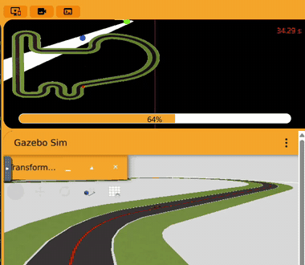
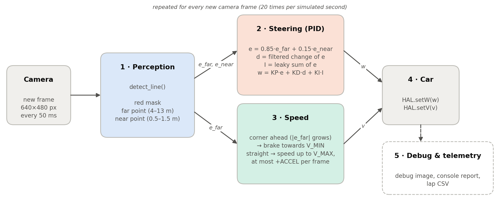
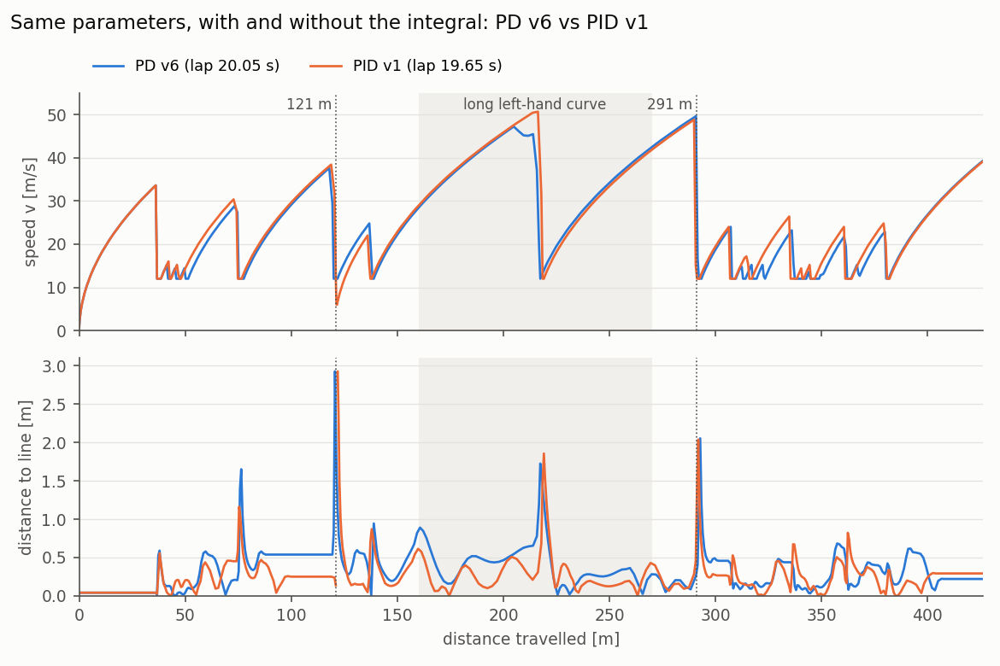
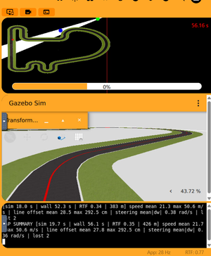
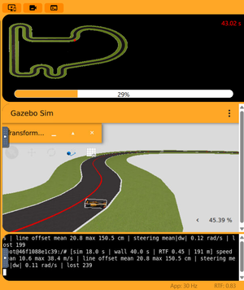
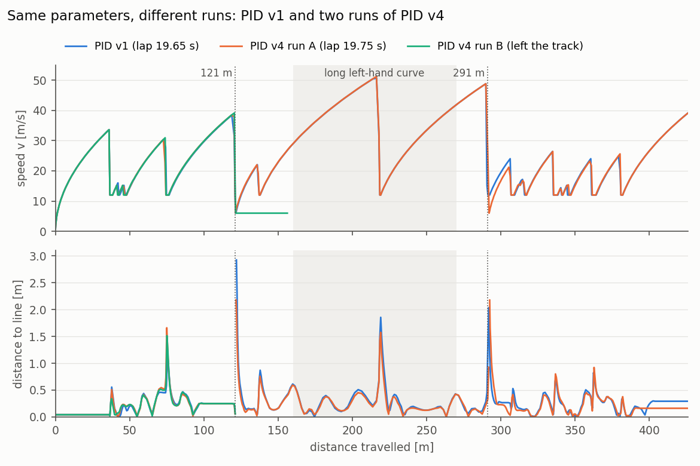
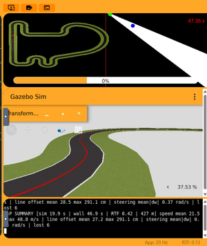
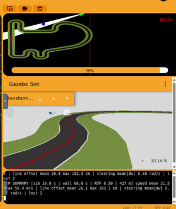
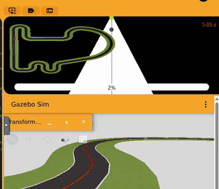

# Follow Line – PID controller

A **proportional-integral-derivative (PID)** steering controller for the F1 car
of the
[Follow Line exercise](https://jderobot.github.io/RoboticsAcademy/exercises/AutonomousCars/follow_line/)
of JdeRobot Robotics Academy. It was developed and tested on the **Unibotics**
online simulator (Simple Circuit), using the original Robotics Backend Docker
image. Only the controller code is ours; nothing in the environment was changed.

The PID controller is the PD controller of this project plus an **integral
term** on the steering. Perception, speed policy, derivative term and telemetry
are the same code, so any difference between the two controllers comes from
the integral.



*The PID controller (v1) in a corner of the Simple Circuit, in Unibotics.*

| | |
|---|---|
| **Final version** | PID v1, [`pid_controller.py`](pid_controller.py) |
| **Starting point** | the final PD controller (v6) + the integral term (section 4.1) |
| **Lap time, simulated** (from the lap CSV) | **19.65 s** (PD v6: 20.05 s) |
| Lap time, Unibotics timer | 56.16 s (RTF 0.35 on the test laptop) |
| Line lost during the lap | 2 frames (0.10 s) in one corner, then found again (PD v6: never) |
| Distance to the line, mean / max | 0.28 m / 2.92 m (PD v6: 0.34 m / 2.93 m) |
| Valid for | **one lap** from a standstill, and at these speeds it completes the lap only in some runs (sections 4.4 and 4.5) |

---

## 1. How to run

1. Start the original Robotics Backend:

   ```bash
   docker run --rm -it -p 6080-6090:6080-6090 -p 7163:7163 jderobot/robotics-backend:latest
   ```

2. Open <https://unibotics.org>, open **Follow Line**, keep the **Simple
   Circuit** and press **Connect**.
3. Paste the whole content of [`pid_controller.py`](pid_controller.py) into the
   editor and press **Play**. Press **Reset** before every new run.

The image panel shows the debug view: the red mask in white, the **far** point
(green), the **near** point (blue) and the image centre (red vertical line).
The console prints a report every 2 s of simulated time and a `LAP SUMMARY`
line after one lap.

**Getting the lap data.** Every run writes a CSV file inside the container. The
console prints its name when the run starts (`Logging this run to
/tmp/PID_HHMMSS.csv`). Copy it from a second terminal **before stopping the
container**, because `--rm` deletes the container together with its files:

```bash
docker ps
```

```bash
docker exec CONTAINER_NAME sh -c "ls /tmp/*.csv"
```

```bash
docker cp CONTAINER_NAME:/tmp/PID_103055.csv .
```

`CONTAINER_NAME` is the value in the `NAMES` column of `docker ps` (for
example `gracious_zhukovsky`). `PID_103055.csv` is an example file name.

---

## 2. How it works



Every new camera frame goes through the same five steps:

1. **Perception** (2.1): find the red line and measure how far it is from the
   image centre at a far point and a near point. This gives the errors `e_far`
   and `e_near`.
2. **Steering** (2.2): the PID law turns the car towards the line,
   `w = KP · e + KD · d + KI · I`, where `d` is how fast the error is changing
   and `I` is the error accumulated over the last second or so.
3. **Speed** (2.3): brake when the far point shows that a corner is coming, and
   accelerate on the straights.
4. **Car**: the commands are sent with `HAL.setW(w)` and `HAL.setV(v)`.
5. **Debug and telemetry** (2.5): debug image in the GUI, console report and
   lap CSV. They only measure; they do not change how the car drives.

### 2.1 Perception (`detect_line`)

**What the camera sees.** The F1 camera is 640×480 px with a 90° horizontal
field of view (focal length 320 px). It sits about 0.10 m above the ground and
looks horizontally. The horizon is therefore at row 240, and a point on the
ground at distance *d* appears at row ≈ 240 + 33/*d*:

| image row | 243 | 248 | 256 | 273 | 306 | 400 |
|---|---|---|---|---|---|---|
| distance ahead | ~10 m | ~4 m | ~2 m | ~1 m | ~0.5 m | ~0.2 m |

The useful look-ahead is packed into the first ~15 rows under the horizon. The
big red triangle at the bottom of the image is only about 0.2 m in front of
the car. The example from the class slides follows the centroid of the whole
mask, which sits at row ~398, so it only reacts when the corner is already
under the car.

**What the code extracts:**

1. Only the ground half of the image (rows ≥ 242) is processed.
2. Red is detected in HSV with **two hue ranges** (0–10 and 165–180), because
   red wraps around H = 0 in OpenCV.
3. `top` is the first row that contains red, which is the farthest visible
   point of the line. Both bands are placed relative to `top`, not at fixed
   rows. They therefore keep working when the line leaves the image sideways
   in a corner.
4. **Far band**, rows `[top, top+6)`, about 4–13 m ahead: it sees the corner
   coming. **Near band**, rows `[top+20, top+60)`, about 0.5–1.5 m ahead: it
   keeps the car on the line.
5. The centroid of each band is computed with `cv2.moments`. Nothing indexes
   `contours[0]` as the slides' code does, so an empty mask cannot crash the
   program. If only one band sees the line, its value is used for both.
6. Each centroid *cx* becomes a normalised error `e = (320 − cx) / 320` in
   [−1, 1], positive when the line is on the left. Because f = 320 px,
   `e ≈ tan(angle to that point)`.

The camera is mounted 4 cm to the left of the car's centre. So even with the
car exactly on the line, the near point appears slightly to the right of the
image centre in the debug view. This is expected.

### 2.2 Steering: the PID law

```
e  = FAR_WEIGHT · e_far + (1 − FAR_WEIGHT) · e_near
Δe = e − e_previous                                   (change in one frame = 50 ms)
d  = D_ALPHA · Δe + (1 − D_ALPHA) · d_previous        (low-pass filter)
I  = clip(I_DECAY · I_previous + e, −I_MAX, I_MAX)    (leaky, clamped sum of the error)
w  = KP · e + KD · d + KI · I
```

* **P term.** `KP · e` turns the car towards the line, more the further away
  the line is. `KP = 4`: a line at the edge of the image (`e = 1`) gives
  4 rad/s of turn.
* **D term.** `KD · d` reacts to how fast the error is changing. It damps the
  weaving (when the car is already returning to the line, it reduces the turn
  before the car overshoots) and anticipates corners (it reacts as soon as the
  error starts growing). In the PD tests it was worth 1.65 s per lap with the
  same parameters, and `KD = 6` gave the best balance between damping and
  nervous steering.
* **I term: what it adds.** In a curve of constant curvature κ taken at speed
  *v*, the car needs a constant turn `w = v·κ`. Once the error stops changing,
  `d = 0`, and a PD can only produce that turn with a non-zero error: the car
  settles at `e ≈ v·κ / KP`, on the outside of the line. In the final PD lap
  the error in the long left-hand curve stays at about −0.22 on average. The
  integral grows while the error keeps the same sign and adds the missing turn
  itself, so the car can ride closer to the line.
* **Why it could make the car faster.** The speed policy (2.3) depends on the
  far error. If the integral keeps the error smaller in the long curve, the
  speed policy brakes less there. This is the main hypothesis of the tests.
* **Leaky integral (`I_DECAY = 0.95`).** Every frame the integral keeps 95 % of
  its value, so it remembers roughly the last 20 frames (1 s). With a constant
  error `e` it settles at `e / (1 − I_DECAY) = 20 · e`. In a long curve the I
  term therefore acts like an extra proportional gain of
  `KI / (1 − I_DECAY) = 2` that builds up over about one second: the
  low-frequency gain goes from 4 to 6, and the constant error drops by about
  one third. Because of the leak it does not drop to zero; that is the price of
  forgetting old corners.
* **Clamp (`I_MAX = 10`).** The accumulated error is limited, so the I term can
  never add more than `KI · I_MAX = 1` rad/s of turn. A corner needs up to
  5 rad/s, so the integral can help but never dominate the steering.
* **Why the anti-windup is needed.** This circuit links corners in opposite
  directions (the chicanes). An integral that never forgets would keep turning
  towards the previous corner while the car is already in the next one
  ("integral windup"). The leak and the clamp limit that effect.
* **Reset when the line is lost.** When the line disappears, the integral is
  set to zero and the derivative restarts from the current error when the line
  reappears. Old errors are not carried into the recovery.

### 2.3 Speed policy (`target_speed`)

```
v_target = V_MAX − (V_MAX − V_MIN) · min(1, |e_far| / E_BRAKE)
v        = min(v_target, v_previous + ACCEL)
```

* On a straight the far point is centred (`e_far ≈ 0`), so the car runs at
  `V_MAX`. When a corner is coming, the far point moves sideways **before** the
  car reaches it, so the car brakes in advance. It reaches `V_MIN` when
  `|e_far| ≥ E_BRAKE`.
* Braking is instant. Accelerating is limited to `ACCEL` per frame, which is
  `ACCEL / 0.05 s` in m/s² (0.8 → 16 m/s²).
* The **sensitivity** of this policy, `S = (V_MAX − V_MIN) / E_BRAKE`, is how
  many m/s the speed command changes per unit of far error. With a high `S`, a
  small wobble of the error produces a large change of speed.

### 2.4 Robustness details

* **Only new frames are processed.** `HAL.getImage()` returns the same image
  until the camera (20 Hz) sends a new one. The loop compares a sub-sampled
  copy with the previous image and sleeps 2 ms if nothing changed. The control
  law therefore runs exactly once per frame, which makes the derivative a true
  per-frame difference and the integral a true per-frame sum, and the CPU is
  left to Gazebo.
* **Start.** The car does not move until it has seen the line, because the
  camera can take a moment to start after **Play**. The console shows
  `Waiting for the red line` in the meantime.
* **Line lost.** The car drops to `V_MIN / 2` and turns at `W_LOST` towards the
  side where the line was last seen. The integral is reset, and the derivative
  restarts when the line reappears (2.2).

### 2.5 Telemetry and lap CSV (`Telemetry` class)

Unibotics only shows the lap timer and the real-time factor (RTF). That is not
enough to compare versions fairly (section 3) or to understand *why* the car
behaves as it does. So the controller includes a measurement block that saves
the data of every frame. It does not influence how the car is driven.

* A console report every 40 frames (2 s of simulated time). The `LAP SUMMARY`
  line is printed once 425 m have been driven. The red line is 429 m long, and
  the car cuts the corners slightly. Logging stops there, so each CSV holds
  exactly one lap.
* One CSV row per frame:

| Column | Meaning |
|---|---|
| `sim_time` | Simulated time = frames × 0.05 s. The camera produces one frame every 50 ms of simulated time |
| `dist` | Distance travelled = Σ v · 0.05 s. The F1 model applies the commanded speed directly |
| `v`, `w` | Speed and steering commands sent to the car |
| `line_offset` | Distance [m] between the car's centre line and the red line. It is estimated from the camera geometry at rows 395–405 (≈ 0.2 m ahead) and corrected for the 4 cm camera offset |
| `lost` | 1 if no red was visible in the image |

The `LAP SUMMARY` gives the same values aggregated over the lap. It also
reports the wall-clock time and the RTF, and the mean |Δw| between frames, which
measures how smooth the steering is:

```
LAP SUMMARY [sim … s | wall … s | RTF … | 426 m] speed mean … max … m/s |
line offset mean … max … cm | steering mean|dw| … rad/s | lost …
```

`line_offset` is an estimate, because it also contains a small part of the
heading error. In an offline replica of the circuit (a Python model of the
track, car and camera, used before testing in Unibotics), where the true
distance is known, it was within a few centimetres of it (mean 20.4 vs
19.2 cm, max 99.4 vs 96.4 cm).

### 2.6 Parameters (final version, PID v1)

| Parameter | Value | Meaning |
|---|---|---|
| `KP` | 4.0 | proportional gain [rad/s per unit of error] |
| `KD` | 6.0 | derivative gain [rad/s per unit of error change per frame] |
| `D_ALPHA` | 0.7 | low-pass filter on the derivative (1 = no filter) |
| `KI` | 0.1 | integral gain [rad/s per unit of accumulated error] |
| `I_DECAY` | 0.95 | share of the integral kept from one frame to the next (memory ≈ 1 s) |
| `I_MAX` | 10.0 | clamp of the accumulated error (I term ≤ 1 rad/s) |
| `V_MAX` | 80.0 m/s | speed with the far point centred (never reached; it sets the target speed at every far error) |
| `V_MIN` | 12.0 m/s | speed in the tightest corners |
| `E_BRAKE` | 0.5 | far error at which the speed reaches `V_MIN` (line ≈ 27° off-centre) |
| `ACCEL` | 0.8 m/s per frame | maximum speed increase per frame (16 m/s²); braking is instant |
| `FAR_WEIGHT` | 0.85 | share of the far point in the steering error |
| `W_LOST` | 1.5 rad/s | search turn rate if the line is lost |

The telemetry constants (`TELEMETRY`, `REPORT_EVERY`, `CSV_LOG`, `RUN_NAME`,
`LAP_LENGTH`, …) only change what is printed and saved.

---

## 3. Measuring the lap: simulated time, not the timer

The Unibotics timer counts **wall-clock** time (`datetime.now()` in the
exercise's `lap.py`). The car moves in **simulated** time. The two are related
by the RTF = simulated time / real time. When the computer is slower, Gazebo
simulates fewer seconds per real second. The same lap then takes longer on the
timer, even though the car does exactly the same thing.

This was measured during the P controller tests. The same configuration was
run twice on the same laptop: on battery after waking from sleep, the timer
showed 97.36 s (RTF 0.27); plugged in, 61.00 s (RTF 0.43). The simulated lap
was 26.0 s both times.

**So all comparisons use the simulated lap time from the CSV:** the
`sim_time` of the first row where `dist` reaches 425 m. The `LAP SUMMARY` gives
the same value, rounded. The timer is still reported, always together with its
RTF. Each version is driven once, and the 425 m end point depends slightly on
how the car cuts the corners. So **differences below about 0.5 s are treated as
ties**.

---

## 4. Tests

### 4.1 Starting point: PD v6 + the integral term

As with the PD controller, the first PID version does not start from scratch.
It takes **all the values of the final PD controller (v6)** and adds the
integral term:

| Parameter | PID v1 | Where it comes from |
|---|---|---|
| `KP` | 4.0 | Same in every P and PD version |
| `KD` / `D_ALPHA` | 6.0 / 0.7 | PD tests: `KD = 6` was better than 0 and 10 |
| `KI` | **0.1** | New: from the offline tuning, checked on the PD v6 lap data (below) |
| `I_DECAY` | **0.95** | New: memory of about 1 s |
| `I_MAX` | **10.0** | New: I term limited to 1 rad/s |
| `V_MAX` / `ACCEL` | 80 / 0.8 | PD v6 |
| `V_MIN` / `E_BRAKE` | 12 / 0.5 | P and PD tests |
| `FAR_WEIGHT` | 0.85 | P and PD tests |

The reasons for this choice:

* **The tuning of the PD carries over.** Perception, speed policy and the
  derivative are the same code in both controllers; only the integral is new.
* **One change at a time.** The only difference from PD v6 is the integral
  term, so the first lap already measures what the integral adds. The same
  approach worked for the PD: PD v1 was P v7 plus the derivative, and that
  single lap showed what the derivative was worth.
* **The integral has the right size.** The error of the PD v6 lap was rebuilt
  from its logged steering (`w = KP·e + KD·d`), and the integral that the code
  would have produced with `KI = 0.1`, `I_DECAY = 0.95` and `I_MAX = 10` was
  computed on it. This is not a simulation, because with the integral active
  the trajectory would change. It does show the order of magnitude:

| Where (PD v6 lap) | P term, RMS | I term, RMS / max | Frames where the I term pushes against the error |
|---|---|---|---|
| Long left-hand curve (165–265 m) | 1.02 rad/s | 0.45 / 0.62 rad/s | 4 |
| First bends (36–60 m) | 1.89 rad/s | 0.56 / 0.74 rad/s | 0 |
| Chicanes (300–370 m) | 1.81 rad/s | 0.43 / 0.67 rad/s | 12 |
| Whole lap | 1.48 rad/s | 0.42 / 0.74 rad/s | 47 |

  * In the **long curve**, where the PD keeps a constant error, the I term
    would be about 45 % of the P term and almost always in the right
    direction. That is the same proportion the D term had with `KD = 6`, which
    worked well.
  * In the **chicanes** the error changes side quickly, and the integral
    sometimes still pushes towards the previous corner (12 frames). This is the
    windup risk, and the reason for the leak and the clamp. With `KI = 0.05`
    both the I term and those frames would halve (22 frames over the lap
    instead of 47).
  * **Image stalls.** Before the corner at 121 m the camera image freezes for
    about 1 s in the PD v6 lap. During a stall the derivative is zero, but the
    integral keeps adding the same frozen error, up to 0.4–0.7 rad/s. At that
    corner it pushes in the direction of the turn, which helps the car turn in,
    but it may make it overshoot at the exit.

* **No margin to start with.** PD v6 is at the limit: it ends 2.93 m from the
  line at the corner at 121 m, and PD v5, a little faster, left the track. If
  PID v1 fails, it does not necessarily mean that the integral is worse, only
  that there is no room for any change at these speeds.

### 4.2 What PID v1 has to beat

| | PD v6 (final PD) |
|---|---|
| Simulated lap | 20.05 s |
| Line lost | never |
| Distance to the line, mean / max | 0.34 / 2.93 m |
| Long curve: mean error / sign changes of `w` | −0.22 / 3 |
| Long curve: braking at about 216 m | from 46 m/s down to 12 m/s, 1.73 m from the line |

**Expected result.** If the hypothesis holds, the integral reduces the
constant error in the long curve by about one third, the speed policy brakes
less there, and the lap gets faster. The risk is in the chicanes and at the
corner exits, where the integral can keep turning towards the previous corner.

### 4.3 Plan for the next versions

This plan was written before running PID v1. The decision taken after PID v1
is explained with its results (section 4.4).

| If PID v1… | Then PID v2… |
|---|---|
| completes the lap and stays closer to the line in the long curve | raises the speed again (for example `ACCEL` 0.85) |
| leaves the track, or weaves in the chicanes | `KI = 0.05`: half the integral and half the frames where it pushes the wrong way |
| behaves almost exactly like PD v6 | `KI = 0.15`: the integral is too weak to matter |

### 4.4 Iterations

**Method.** Each version is driven for one lap on the Simple Circuit, with
**Reset** before each run. For every lap we keep the timer screenshot with the
`LAP SUMMARY`, a video of the same section of the circuit, and the lap CSV.
Each new set of parameters is chosen from the data of the previous lap.

| Version | KI | I_DECAY | I_MAX | V_MAX | ACCEL | Sim lap | Timer (RTF) | Mean speed | Dist. to line mean / max | Lost |
|---|---|---|---|---|---|---|---|---|---|---|
| **PID v1** | 0.1 | 0.95 | 10 | 80 | 0.8 | **19.65 s** | 56.16 s (0.35) | 21.7 m/s | 0.28 / 2.92 m | 2 |
| PID v2 | **0.15** | 0.95 | 10 | 80 | 0.8 | left the track at ~119 m | – | – | – | – |
| PID v3 | **0.125** | 0.95 | 10 | 80 | 0.8 | 19.9 s (1 of several runs) | 47.36 s (0.42) | 21.5 m/s | 0.27 / 2.91 m | 6 |
| PID v4 | **0.11** | 0.95 | 10 | 80 | 0.8 | 19.75 s (2 of 3 runs) | – | 21.6 m/s | 0.27 / 2.18 m | 2 |

`KP = 4.0`, `KD = 6.0`, `D_ALPHA = 0.7`, `V_MIN = 12`, `E_BRAKE = 0.5` and
`FAR_WEIGHT = 0.85` in all PID versions. The timer comes from the screenshot
and the RTF from the `LAP SUMMARY`; the lap times compared are the simulated
ones from the CSVs, as always (section 3). Bold values changed from the
previous version. PID v3 and v4 completed the lap only in some runs. The
values of PID v3 come from the `LAP SUMMARY` of its completed run, and those of
PID v4 from the CSV of its first completed run (run A below).

#### PID v1: the integral alone saves 0.40 s

PID v1 has exactly the same parameters as PD v6, plus the integral term:

| | PD v6 | **PID v1** |
|---|---|---|
| Simulated lap | 20.05 s | **19.65 s** (−0.40 s) |
| Line lost | never | 2 frames (0.10 s) at 121 m |
| Distance to the line, mean / max | 0.34 / 2.93 m | **0.28** / 2.92 m |
| Long curve (165–265 m): mean error | −0.22 | **−0.14** (−37 %) |
| Long curve: mean distance to the line | 0.43 m | **0.33 m** |
| Long curve: sign changes of `w` | 3 | 5 |
| Steering zigzag frames | 10 | 9 |
| Mean steering change per frame | 0.33 rad/s | 0.36 rad/s |
| Max speed | 49.6 m/s | 50.6 m/s |



*Speed and distance to the line along the lap. Blue: PD v6. Orange: PID v1.
Same parameters; the only difference is the integral term.*

Where the 0.40 s are gained and lost:

| Section of the lap | PD v6 | PID v1 | Difference |
|---|---|---|---|
| 0–115 m (start and first bends) | 6.20 s | 5.95 s | **−0.25 s** |
| 115–130 m (corner at 121 m) | 0.80 s | 1.00 s | +0.20 s |
| 130–160 m | 1.50 s | 1.55 s | +0.05 s |
| 160–270 m (long left-hand curve) | 3.45 s | 3.40 s | −0.05 s |
| 270–425 m (chicanes and final straight) | 8.10 s | 7.75 s | **−0.35 s** |

* **The integral reduces the constant error as predicted.** In the long curve
  the mean error drops from −0.22 to −0.14, 37 % (the prediction in 2.2 was
  about one third), and the car rides closer to the line (0.33 m instead of
  0.43 m on average).
* **It pays off where the bends keep the same direction.** In the first bends
  (36–60 m) the error has the same sign for several bends in a row. The
  integral keeps the car closer to the line there, the speed policy brakes
  less, and the first 115 m are 0.25 s faster. The corner at 76 m is entered
  faster (30.4 against 28.8 m/s) and the car stays closer to the line
  (1.16 m against 1.65 m).
* **No windup problem in the chicanes.** The section with the chicanes and the
  final straight is 0.35 s faster, and the steering does not zigzag more
  (9 frames against 10).
* **The long curve itself is not faster** (−0.05 s). The car still reaches the
  end of the curve at about 50 m/s and brakes down to 12 m/s at about 217 m.
  There the speed policy brakes because of the corner ahead, not because of
  the constant error.
* **The corner at 121 m costs 0.20 s.** The line is lost for 2 frames. This is
  the corner where PD v6 already ended 2.93 m from the line, and PID v1 enters
  it slightly faster (38.4 against 37.6 m/s). Just before it, the camera image
  stalls for about 1 s (100–119 m). As predicted in 4.1, the integral keeps
  adding the frozen error during the stall: the steering command drifts from
  −0.35 to −0.61 rad/s while the image does not change. At the corner entry
  itself the I term is close to zero, so it did not push against the turn. The
  loss is mostly explained by a corner that was already at the limit, and the
  drift during the stall may have contributed.

**Decision: raise `KI` to 0.15.** The plan of section 4.3 was to raise the
speed if PID v1 completed the lap closer to the line. But the car already
loses the line at the corner at 121 m, and PD v5 showed that more speed takes
the car off the track. The data shows that the integral helps wherever the
curvature keeps the same direction, and does not cause windup in the
chicanes. **PID v2 = PID v1 with `KI = 0.15`** (+50 %), nothing else changed.

* **Success:** faster than 19.65 s, without more lost frames.
* **`KI` too high:** the zigzag frames or the mean steering change rise
  clearly, the car loses the line in the chicanes, or the drift during the
  image stall makes the corner at 121 m worse. In that case PID v1 is kept.

| Lap completed | Same section of the circuit |
|---|---|
| [](results/pid_v1_lap_time.png) |  |

[CSV](results/pid_v1_lap.csv) · [full video](results/pid_v1_curve.mp4)

#### PID v2: `KI = 0.15` leaves the track

PID v2 is PID v1 with `KI` raised from 0.1 to 0.15; nothing else changes.

**Result:** the car **left the track at the corner at 121 m** and did not
complete the lap. Only the screenshot of that moment was kept, but its console
shows where it happened. The counter of frames without the line grows by 40
every 2 s (199 → 239), so every frame is lost, while the distance grows at the
search speed of 6 m/s. Counting back, the line was lost at about 6.05 s of
simulated time and **119 m**, at the entry of the corner. The car had reached
38.4 m/s, the same speed at which PID v1 entered that corner.

| PID v2: off the track |
|---|
| [](results/pid_v2_derail.png) |

Together with PD v6 (which is the same controller with `KI = 0`), this gives
three laps that differ only in the integral gain:

| `KI` | Simulated lap | Corner at 121 m |
|---|---|---|
| 0 (PD v6) | 20.05 s | line kept, 2.93 m away |
| **0.1 (PID v1)** | **19.65 s** | line lost for 2 frames |
| 0.15 (PID v2) | – | **left the track** |

* **More integral, worse at the corner at 121 m.** The corner was already at
  the limit without the integral. With `KI = 0.1` the car loses the line for a
  moment, and with `KI = 0.15` it leaves the track there.
* **This matches the image stall described in PID v1.** Just before that
  corner the camera image freezes for about 1 s, and the integral keeps adding
  the frozen error, so the steering drifts while the car sees nothing new. The
  drift grows with `KI`. Without the CSV of PID v2 this cannot be measured
  directly, but the car failed exactly at the point where the drift acts.
* **Where the integral helps, it needs time to build up.** The gains of
  PID v1 come from sections where the error keeps the same sign (first bends,
  long curve). The risk comes from a corner reached right after a stall. A
  larger `KI` raises both, and at this corner the risk wins.

**Decision.** `KI = 0.15` is too high. The next runs looked for the limit
between 0.1 and 0.15 (PID v3 and v4).

#### PID v3 and v4: between 0.1 and 0.15, and the problem of repeatability

Two intermediate values were tried, and several runs were made with each one:

* **PID v3: `KI = 0.125`.** The first run completed the lap: 19.9 s of
  simulated time (`LAP SUMMARY`), 47.36 s on the timer (RTF 0.42), but the line
  was lost for 6 frames and the car went up to 2.91 m from it. **Later runs with
  the same values left the track.**
* **`KI = 0.12`.** Some runs completed the lap and others left the track. No
  data was kept from these runs.
* **PID v4: `KI = 0.11`.** Three runs were made one after the other in the
  same session, with the same values. The CSV file names give the time each
  run started:
  * **Run A (19:36:23) completed the lap**: 19.75 s of simulated time, line
    lost for 1 frame at the corner at 121 m and 1 frame at the corner at 291 m,
    at most 2.18 m from it, maximum speed 51.2 m/s. Its CSV was kept.
  * **Run B (19:38:57) left the track** at the corner at 121 m: the car entered
    it at 39.1 m/s, lost the line at 121.4 m and never found it again. Its CSV
    was kept.
  * **Run C (19:41:26) completed the lap**: 19.8 s of simulated time
    (`LAP SUMMARY`), line lost for 2 frames, at most 1.83 m from it, maximum
    speed 50.4 m/s. It was recorded on video, but its CSV was not copied from
    the simulator.
* **`KI = 0.1` (the values of PID v1), run again several times**, also completed
  the lap only in some of the runs.

| `KI` | Runs | Best completed lap (simulated) | Line lost in that lap |
|---|---|---|---|
| 0.1 (PID v1) | completed in some runs | **19.65 s** | 2 frames |
| 0.11 (PID v4) | completed in 2 of 3 runs | 19.75 s | 2 frames |
| 0.12 | completed in some runs | – | – |
| 0.125 (PID v3) | completed once, then left the track | 19.9 s | 6 frames |
| 0.15 (PID v2) | left the track | – | – |

The lap time of PID v3 comes from its `LAP SUMMARY` (rounded to 0.1 s), because
the CSV of that run was not kept.



*Speed and distance to the line along the lap. Blue: PID v1. Orange: PID v4,
run A (completed). Green: PID v4, run B (left the track at 121 m). Up to the
corner at 121 m the three runs are almost identical; the outcome is decided at
that corner.*

| PID v3 (`KI = 0.125`): lap completed | PID v4 (`KI = 0.11`): run C, lap completed |
|---|---|
| [](results/pid_v3_lap_time.png) | [](results/pid_v4_lap_summary.png) |



*PID v4 (`KI = 0.11`), run C, played 4 times faster than the recording. The
recording starts with the end of run B (`lost 117` in the console) and then
shows the full lap of run C.*

[Full recording of runs B and C](results/pid_v4_two_runs.mp4) · [CSV of run A
(completed)](results/pid_v4_lap_completed_run.csv) · [CSV of run B (left the
track)](results/pid_v4_lap_failed_run.csv)

**What these runs show:**

* **At these speeds, the result changes from run to run.** With the same
  parameters, runs A and C of PID v4 kept the line at the corner at 121 m (or
  found it again after one frame), and run B, between them, left the track.
  The figure above shows that the three runs drive almost the same until that
  corner. The margin at that corner is so small that small
  differences between runs decide the outcome.
* **The most likely source of those differences is the image stall just
  before the corner.** In the logged laps compared below, the camera image
  freezes for 11–15 frames between about 97 and 119 m, and the car then
  reaches the corner with a late image. How long the stall lasts and where it
  ends most likely depend on how busy the laptop is, so they change from run
  to run. The entry speed decides the rest:

| Lap | Speed entering the corner at 121 m | Result at that corner |
|---|---|---|
| PD v6 | 37.6 m/s | line kept, 2.93 m away |
| PID v1 | 38.4 m/s | line lost for 2 frames, found again |
| PID v4, run A | 38.4 m/s | line lost for 1 frame, found again |
| PID v4, run B | 39.1 m/s | line lost, left the track |

* **One lap per version is not enough at the limit.** The tests used one lap
  per version, which was enough while the car had margin. At these speeds a
  setting can complete one lap and fail the next, so a single lap cannot tell
  close settings apart.
* **A larger `KI` does not pay off.** The completed laps with `KI = 0.11` and
  `0.125` are not faster than PID v1 (19.75 and 19.9 s against 19.65 s), they
  lose the line for more frames, and the higher values fail more often.

**Final version: PID v1 (`KI = 0.1`).** It is the fastest completed PID lap,
and raising `KI` makes the controller less stable without making it faster.
The values in [`pid_controller.py`](pid_controller.py) are those of PID v1.

### 4.5 Optimised for one lap, not for several

As with the PD controller, the parameters were tuned for the fastest **single
lap** from a standstill. The first lap ends on the long straight at about
39 m/s, and the car keeps accelerating across the start line, so it reaches the
first corner of the second lap much faster than in the first lap (an
estimated ~52 m/s instead of 33.6 m/s, computed for the same speed settings in
the PD controller). With the PID, the car **sometimes leaves the track in the
second lap** at that corner, and sometimes continues.

The same happens with **consecutive single laps** (pressing **Reset** and
**Play** again): with the same parameters, some laps are completed and others
are not (section 4.4).

---

## 5. Final result

The values in [`pid_controller.py`](pid_controller.py) are those of PID v1.

| | Lap (simulated time) |
|---|---|
| **PID v1 (final)** | **19.65 s** |
| PD v6 (final PD, same parameters without the integral) | 20.05 s |

Over one lap the integral saves **0.40 s** against the best PD. That is within
the ±0.5 s tie margin, but the gain is consistent with the data: it comes from
the sections where the curvature keeps the same direction (first bends) and
from the chicanes, and it is lost only at the corner at 121 m. On the
Unibotics timer the lap took 56.16 s, at an RTF of 0.35. The setting is valid
for one lap from a standstill, and at these speeds it completes the lap only in
some runs (sections 4.4 and 4.5).

---

## 6. Limitations

* **Not repeatable at these speeds.** With the same parameters, some runs
  complete the lap and others leave the track at the corner at 121 m
  (section 4.4). The reported times are those of the completed laps.
* **The leaky integral reduces the constant error, but does not remove it.**
  With `I_DECAY = 0.95` it acts like a gain of 6 instead of 4 in long curves
  (2.2). A longer memory would remove more of the error, but would make the
  windup in the chicanes worse.
* **Windup.** In the chicanes the integral can keep turning towards the
  previous corner for a short time.
* **Image stalls.** In most laps there are short stretches where the camera
  image does not change for 0.5–2.5 s, most likely because the simulator's
  rendering lags behind on the test laptop. During a stall the derivative is
  zero, but the integral keeps accumulating the frozen error; when the image
  updates, the error jumps and the derivative produces a short kick. One of
  these stalls happens right before the corner at 121 m.
* **Noise.** The derivative amplifies the pixel noise of the measured line
  position. This limits how large `KD` can be.
* **One lap only.** In the second lap the car reaches the first corner much
  faster than in the first one, and sometimes leaves the track (section 4.5).
* **Tuned for the Simple Circuit only.**

---

## 7. Files

| File | Content |
|---|---|
| [`pid_controller.py`](pid_controller.py) | The controller (final version, PID v1) |
| [`results/pid_v1_lap.csv`](results/pid_v1_lap.csv) | Lap data of PID v1 (one row per frame) |
| [`results/pid_v1_lap_time.png`](results/pid_v1_lap_time.png) | Timer and `LAP SUMMARY` at the end of the PID v1 lap |
| [`results/pid_v1_curve.mp4`](results/pid_v1_curve.mp4) | Video of PID v1 in a section of the circuit |
| [`results/pid_v2_derail.png`](results/pid_v2_derail.png) | PID v2 off the track at the corner at 121 m |
| [`results/pid_v3_lap_time.png`](results/pid_v3_lap_time.png) | Timer and `LAP SUMMARY` of the completed PID v3 lap |
| [`results/pid_v4_two_runs.mp4`](results/pid_v4_two_runs.mp4) | PID v4: end of run B (failed), then the full lap of run C (compressed recording) |
| [`results/pid_v4_lap_summary.png`](results/pid_v4_lap_summary.png) | Last frame of that recording, with the `LAP SUMMARY` of run C |
| [`results/pid_v4_lap_completed_run.csv`](results/pid_v4_lap_completed_run.csv) | Lap data of PID v4 run A (completed lap) |
| [`results/pid_v4_lap_failed_run.csv`](results/pid_v4_lap_failed_run.csv) | Lap data of PID v4 run B (left the track at 121 m) |
| [`results/gif/`](results/gif/) | The videos as GIFs, for this page |
| [`results/thumbs/`](results/thumbs/) | Small copies of the screenshots shown on this page (click them for full size) |
| [`results/plots/`](results/plots/) | The diagram and the figures shown on this page |
