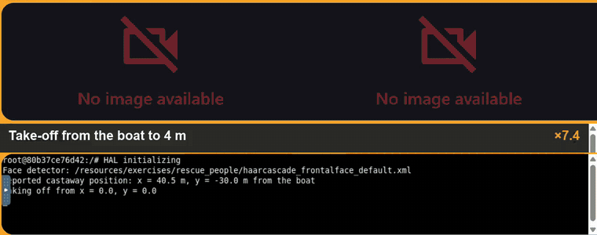
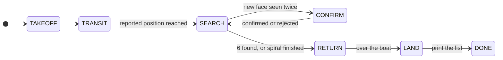
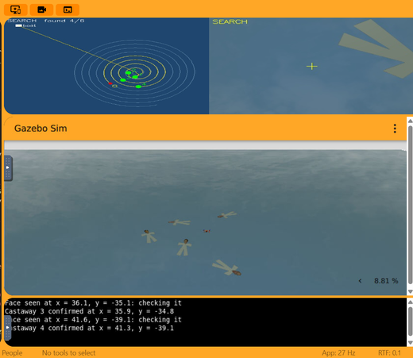
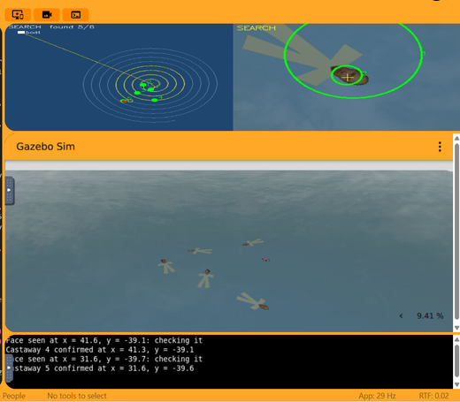
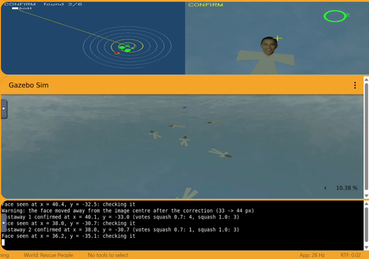
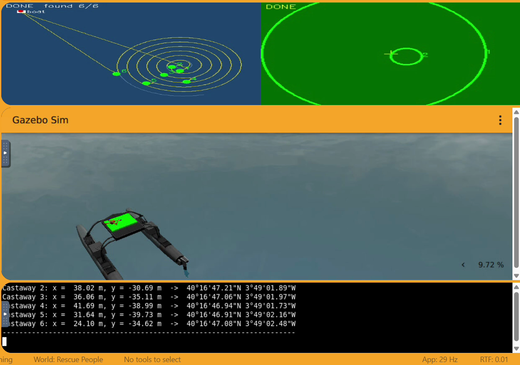
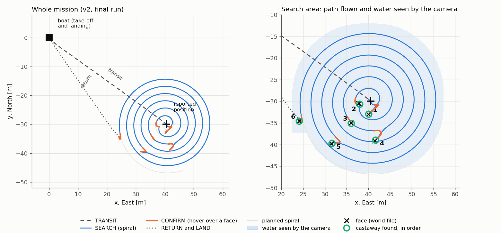
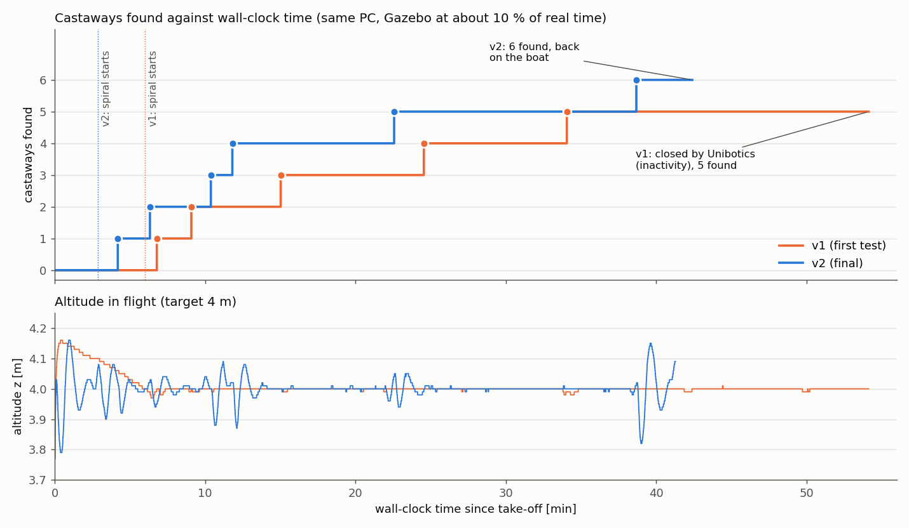

# Rescue People – drone search with face detection

A quadrotor that takes off from a safety boat, flies to the GPS position where
a group of castaways was reported, sweeps the area along an **Archimedean
spiral**, recognises the **face** of every person in the water with its
downward-looking camera, stores where each one is, and flies back to the boat
with the list. This is the
[Rescue People exercise](https://jderobot.github.io/RoboticsAcademy/exercises/Drones/rescue_people/)
of JdeRobot Robotics Academy. It was developed and tested on the **Unibotics**
online simulator, using the original Robotics Backend Docker image on a Windows
PC. Only the mission code is ours; nothing in the environment was changed.



*The final run (v2), sped up ×7.4: mission map (left), ventral camera with the
detected faces (right), the phase of the mission (dark bar) and the console.
The full screen, including the Gazebo view, is in
[`results/rescue_v2_final_run_2min.mp4`](results/rescue_v2_final_run_2min.mp4).
Section 6.1 explains what happens at each moment.*

| | |
|---|---|
| **Final version** | v2, [`rescue_people.py`](rescue_people.py) |
| **Result** | **6 of 6 castaways found**, back on the boat and landed |
| **Position error** (against the faces in the world file) | **0.06–0.30 m**, mean 0.18 m |
| False detections reported as castaways | none |
| Mission time, wall clock | 42 min 25 s after take-off, with Gazebo running at about 10 % of real time (about 4–5 min of simulated time) |
| First test (v1) | 5 of 6 found in 54 min, then Unibotics closed the session for inactivity (section 4) |

---

## 1. The exercise

A boat is at **40°16'48.2"N, 3°49'03.5"W**. The castaways were last reported at
**40°16'47.23"N, 3°49'01.78"W**, about 40 m to the East and 30 m to the South of
the boat. Six people are floating face up near that point, each with a
different orientation. The drone has to:

1. take off from the boat and fly to the reported position,
2. search the area around it,
3. identify each castaway by **face detection**, without counting anyone twice,
4. return to the boat, land, and give the position of each of the six.

The drone has a ventral (downward-looking) camera and a frontal camera. Only the
ventral one is used. The course notes gave three hints, and the code follows
all three:

* `set_cmd_pos` is precise but slow; `set_cmd_vel` is fast, but then the
  altitude has to be controlled by the program (section 3.3).
* Search along an Archimedean spiral `r = a + b·θ`, with the distance between
  turns smaller than the area seen by the camera (section 3.4).
* The face detector only finds upright faces, so rotate the images
  (section 3.5).

---

## 2. How to run

1. Start the original Robotics Backend:

   ```bash
   docker run --rm -it -p 6080-6090:6080-6090 -p 7163:7163 jderobot/robotics-backend:latest
   ```

2. Open <https://unibotics.org>, open **Rescue People** and press **Connect**.
3. Paste the whole content of [`rescue_people.py`](rescue_people.py) into the
   editor and press **Play**.

What appears on screen:

* **Left panel: mission map.** Top view with North up: the boat, the planned
  spiral (light), the path flown (yellow), the drone (red dot), the current
  target (yellow circle) and the castaways found (green dots, numbered). The
  first line shows the phase and how many castaways have been found.
* **Right panel: ventral camera.** The image centre is marked with a yellow
  cross. Each detected face gets a green circle with its number of votes
  (section 3.5).
* **Console.** One line per event (face seen, castaway confirmed, false
  detection, return, landing) and, at the end, the list of positions in metres
  and in GPS coordinates.

On the test PC a complete mission takes about 45 minutes of wall-clock time.
Unibotics closes the session after a while without mouse or keyboard input,
after showing an **Inactivity Alert** with a 60 s countdown; press
**Continue** when it appears.

**Getting the mission log.** Every run writes a CSV file inside the container.
The console prints its name after take-off (`Logging this mission to
/tmp/RESCUE_HHMMSS.csv`). Copy it from a second terminal **before stopping the
container**, because `--rm` deletes the container together with its files:

```bash
docker ps
```

```bash
docker exec CONTAINER_NAME sh -c "ls /tmp/*.csv"
```

```bash
docker cp CONTAINER_NAME:/tmp/RESCUE_150545.csv .
```

`CONTAINER_NAME` is the value in the `NAMES` column of `docker ps`.
`RESCUE_150545.csv` is an example file name.

---

## 3. How it works

The program is a single loop that runs every 0.05 s. In each cycle it reads the
position, the yaw and (when needed) the ventral image, decides what to do
according to the current phase, sends one motion command and writes one row of
the log.

| Part of the code | What it does |
|---|---|
| `gps_to_local`, `local_to_gps_text` | GPS ↔ metres relative to the boat (3.1) |
| `spiral_waypoints` | Points of the search spiral (3.4) |
| `fly_to` | One motion command towards a target (3.3) |
| `detect_faces`, `merge_detections` | Face detection with rotated images (3.5) |
| `pixel_to_world` | Pixel of the camera → position on the water (3.6) |
| `run_mission` | The state machine (3.2) and the bookkeeping of castaways (3.7) |
| `MissionMap`, `camera_view`, `MissionLog` | Display and log (3.8) |

### 3.1 Coordinates

All positions are in metres in the local frame of `HAL.get_position()`:
origin at the boat, **x towards the East, y towards the North**, z up.

The reported GPS position is converted to that frame with a flat-Earth
approximation, which is accurate over a few tens of metres:

```
y = (lat − lat_boat) · R · π/180
x = (lon − lon_boat) · R · π/180 · cos(lat_boat)        R = 6 371 000 m
```

This gives **x = 40.5 m, y = −30.0 m**: the centre of the search. At the end,
the same formulas are applied in reverse to report each castaway in GPS
coordinates.

### 3.2 The mission as a state machine



| Phase | What the drone does |
|---|---|
| TAKEOFF | `HAL.takeoff(4.0)`. The call returns once the drone is at 4 m. |
| TRANSIT | Flies in a straight line to the reported position, at up to 3 m/s. |
| SEARCH | Follows the spiral at up to 2 m/s and looks for faces every 0.5 m flown. |
| CONFIRM | A new face was seen: leaves the spiral, hovers right above it and looks again. If the face is there, its position is stored. Then it goes back to the spiral where it left it. |
| RETURN | All six found (or the spiral finished): flies back to the boat. |
| LAND | `HAL.land()` on the boat. |
| DONE | Prints the list of castaways in metres and in GPS coordinates. |

### 3.3 Moving the drone

`HAL.set_cmd_pos(x, y, z, yaw)` is the simplest command, but the drone wrapper
limits its speed to 1 m/s. The final version uses
`HAL.set_cmd_mix(vx, vy, z, yaw_rate)` instead: the program gives the
horizontal velocity, and the drone's own controller keeps the altitude `z`.
That is the advantage of `set_cmd_mix` over `set_cmd_vel`, where the altitude
would also have to be controlled by the program.

The velocity points towards the current target, and its size is the smallest
of three limits:

```
speed = min( phase speed,  sqrt(2 · 0.8 · d),  0.8 · d )      d = distance to the target
```

* the **phase speed**: 3 m/s in TRANSIT and RETURN, 2 m/s in SEARCH, 1 m/s in
  CONFIRM;
* a **braking profile**: the drone cannot stop at once, so its speed is kept
  low enough to brake on the target with a deceleration of 0.8 m/s²;
* a **proportional term** that brings it gently onto the target in the last
  centimetres.

The drone keeps the **yaw** it had after take-off for the whole mission (a
small yaw-rate correction, `1.0 · yaw error`, fixes any drift). It moves in any
direction without turning, so the camera image always has the same
orientation with respect to the map.

`MOTION = "position"` switches back to `set_cmd_pos`; it is the method of the
first test (v1).

### 3.4 The search path: Archimedean spiral

The spiral is `r = b·θ`, centred on the reported position (`a = 0`: it starts
right at the reported point, where the castaways are most likely to be). Every
turn moves the path outwards by `2π·b`, so `b` is chosen from the distance
between turns:

```
b = SPIRAL_SPACING / 2π = 2.5 / 2π = 0.40 m/rad
```

**Why 2.5 m.** At 4 m the camera sees a rectangle of water of about
**4.5 m × 3.4 m** (horizontal field of view 59°, 320 × 240 image). The
spacing between turns must be smaller than the narrowest side of that
rectangle, so that consecutive turns overlap (by about 0.9 m) and no strip of
water is left unseen. Section 6.4 shows the water that the camera actually
covered.

**Why 17 m.** The spiral ends at a radius of 17 m (about 6.8 turns, 364 m of
path). The farthest castaway's face is 17.0 m from the reported point; since the
camera sees about 2 m to each side of the path, the last turn covers it.

**How the drone follows it.** The spiral is turned into points every 0.5 m
along the curve (the angle step is `0.5 / sqrt(r² + b²)`, so the points are
equally spaced along the path, not in angle). The target is a point that runs
**2 m ahead** of the drone along the spiral, which gives a smooth path. In the
inner turns the radius is small, so the speed is also limited to
`sqrt(0.6 · r)`: this keeps the sideways acceleration `v²/r` at 0.6 m/s² or
less. The drone flies at 2 m/s from a radius of about 6.7 m outwards.

### 3.5 Face detection

The detector is the OpenCV **Haar cascade** for frontal faces provided with the
exercise (`haarcascade_frontalface_default.xml`). Three things make it work on
these images:

1. **Rotations.** The cascade only finds faces that are close to upright, and
   the castaways float with any orientation. The image is rotated in steps of
   **30°** (12 rotations), on a canvas large enough to keep all of it.
2. **Vertical squash.** Each castaway is a 1.5 m × 3 m picture of a person,
   with a real face photograph at the head. In those pictures the face is
   stretched about 1.4 times along the body, so faces look longer than real
   ones. Each rotated image is therefore searched twice: as it is, and
   compressed vertically to **0.7** of its height. In the final run both were
   needed: castaway 2 got 3 votes without the squash and only 1 with it.
3. **Upscaling** by 1.25 before searching. At 4 m a face measures about
   30 × 65 px in the camera image.

Each rotated (and possibly squashed) image is searched, and the centre of every
detected box is mapped back to the original image with the inverse of the same
transformation. The same face is normally found in several rotations: points
closer than 20 px are merged, and the number of merged points is the
detection's number of **votes** (the number shown next to each green circle).
A real face usually collects several votes; many of the false detections (for
example, on the body of the figure or on the boat) have only one.

**Computing cost.** 12 rotations × 2 versions = **24 passes of the detector per
image**, on the same CPU that runs Gazebo. Because the simulator is so slow,
the camera gives many nearly identical images per metre flown. The final
version therefore runs the detector:

* in SEARCH, only after flying **0.5 m** since the last search (enough: the
  camera footprint is 3.4 m long);
* in CONFIRM, only on a **200 × 200 px crop** around the image centre, where
  the face is expected.

### 3.6 From pixel to metres

The camera looks straight down from a height `h` above the water (`z` minus
the 5 cm between the drone's centre and the camera). With the focal length
`f = 160 / tan(59°/2) ≈ 283 px`, a point that is `du` pixels right and `dv`
pixels below the image centre is:

```
forward = −dv · h / f        right = du · h / f
```

The top of the image is the front of the drone and the right of the image is
its right. Both distances are then rotated by the yaw into the map frame and
added to the drone's position. The errors in section 6.3 (0.06–0.30 m) confirm
this model and these axes.

### 3.7 Not counting anyone twice, and not counting false faces

* **Already found.** A detection within **2 m** of a castaway on the list is
  the same person and is ignored. The two closest faces in the world are
  4.2 m apart, so 2 m cannot merge two different people.
* **Candidates.** A new face only stops the search when it has been seen in
  **two searches**, at positions less than 1.5 m apart. A single false
  detection in one image does not stop the drone. A candidate that is not seen
  again within six searches is dropped.
* **Confirmation.** In CONFIRM the drone flies to the candidate and waits until
  it is **hovering** above it (closer than 0.35 m and slower than 0.3 m/s).
  Then it looks again, using the central crop. If the face is not near the
  image centre, the hover point is moved to the new estimate (up to three
  times). When the face is found three times within 30 px of the centre, the
  stored position is the **median of those three** measurements.
* **Rejection.** If the face is not found in 8 consecutive checks, or the
  confirmation takes longer than 60 s, the candidate is a false detection. Its
  position is remembered, and no new candidate is accepted within 1.5 m of it.

The position stored is that of the **face**, which is at the head of the
figure, about 1 m from the centre of the 3 m picture.

### 3.8 Output and log

* At the end, the console prints each castaway in metres and in GPS
  coordinates (section 6.3).
* The CSV log has one row per control cycle: `time` (wall-clock seconds since
  the end of take-off), `state`, `x`, `y`, `z`, `yaw`, `found` (castaways
  found so far), `faces` (faces detected in that cycle, or −1 if the detector
  did not run) and `event` (the console message, if any).

### 3.9 Parameters (final version, v2)

| Parameter | Value | Meaning |
|---|---|---|
| `SEARCH_ALTITUDE` | 4.0 m | Flight altitude for the whole mission |
| `MOTION` | `"mix"` | `set_cmd_mix` with the speed control of 3.3 (`"position"`: `set_cmd_pos`) |
| `TRANSIT_SPEED` / `SEARCH_SPEED` / `CONFIRM_SPEED` | 3.0 / 2.0 / 1.0 m/s | Maximum speed in each phase |
| `BRAKE_DECEL`, `LATERAL_ACCEL` | 0.8, 0.6 m/s² | Braking profile, sideways acceleration on the spiral |
| `SPIRAL_SPACING` | 2.5 m | Distance between turns |
| `SPIRAL_MAX_RADIUS` | 17.0 m | Radius at which the search ends |
| `SPIRAL_STEP`, `LOOKAHEAD` | 0.5 m, 2.0 m | Spacing of the spiral points, distance to the target point |
| `ROT_STEP_SEARCH`, `ROT_STEP_CONFIRM` | 30°, 30° | Rotation step of the images |
| `SQUASHES` | 0.7 and 1.0 | Vertical scales searched after each rotation |
| `UPSCALE`, `MIN_FACE`, `MIN_NEIGHBORS` | 1.25, 28 px, 4 | Haar cascade settings |
| `DETECT_EVERY` | 0.5 m | Distance flown between searches |
| `CONFIRM_CROP` | 200 px | Side of the central crop used in CONFIRM |
| `SAME_SURVIVOR_RADIUS` | 2.0 m | Closer than this to a castaway on the list = same person |
| `CANDIDATE_HITS`, `CANDIDATE_RADIUS` | 2, 1.5 m | Sightings needed before stopping for a face |
| `CONFIRM_SAMPLES`, `CONFIRM_CENTRE_PX` | 3, 30 px | Centred detections needed to confirm |
| `CONFIRM_MISSES`, `CONFIRM_TIMEOUT` | 8, 60 s | When a candidate is rejected |

---

## 4. First test (v1)

The first version ([`versions/rescue_people_v1.py`](versions/rescue_people_v1.py))
had the same structure, the same detector and the same bookkeeping, with three
differences:

* it moved the drone with `HAL.set_cmd_pos` (at most 1 m/s);
* it ran the face detector on **every** control cycle while searching, and on
  the full image with 15° steps (48 passes) while confirming;
* the spiral went out to a radius of 22 m.

| [](results/v1_spiral.png) | [](results/v1_fifth_confirmed.png) |
|---|---|
| *v1 on the spiral, with 4 castaways found.* | *v1 after confirming the fifth castaway. The small circle (2 votes) is the face; the large one (1 vote) is a false detection, which was never confirmed.* |

**Result.** After **54 min** of wall-clock time, Unibotics closed the session
for inactivity with **5 of 6** castaways found, so the drone never returned.
The log ([`results/rescue_v1_run.csv`](results/rescue_v1_run.csv)) showed that:

* **No castaway had been skipped.** The five found were the five closest to the
  reported point, found in the order the spiral passed over them. The sixth is
  the farthest one (17 m from the reported point), and the spiral had only
  reached a radius of 15 m.
* **The positions were already accurate**: 0.10–0.26 m from the faces in the
  world file. The coordinate frame, the camera axes and the pixel-to-metre
  model were right.
* **The false detections were filtered out**: none was confirmed.
* **It was very slow**, for three reasons that add up:
  1. Gazebo ran at about **10 % of real time** on the test PC (the percentage
     shown in the Gazebo view);
  2. `set_cmd_pos` limits the speed to 1 m/s: at that real-time factor, the
     drone advanced about 6 m along the spiral per minute of wall-clock time;
  3. the detector (24 passes per image) ran **6 451 times** while searching,
     about 23 times per metre of spiral, mostly on nearly identical images.
     It competed with Gazebo for the same CPU.

---

## 5. Changes from v1 to v2

| | v1 | v2 (final) |
|---|---|---|
| Motion command | `set_cmd_pos` (≤ 1 m/s) | `set_cmd_mix` with own speed control: 3 m/s in transit and return, up to 2 m/s on the spiral (3.3) |
| Speed in the inner turns | 1 m/s, as everywhere | `≤ sqrt(0.6 · r)` |
| Detector while searching | every control cycle | every 0.5 m flown |
| Detector while confirming | full image, 15° steps (48 passes) | 200 px central crop, 30° steps (24 passes) |
| Condition to check a candidate | closer than 0.35 m | closer than 0.35 m **and** slower than 0.3 m/s |
| Spiral radius | 22 m | 17 m (enough to cover the farthest castaway) |
| Web interface refresh | every cycle | 4 times per second |
| Log | no detector column | `faces` column; the console shows the votes of each version of the image |

---

## 6. Final run (v2)

### 6.1 The video, step by step


The 14 min 48 s screen recording, sped up **×7.4** to 2 minutes, with the
phase written on the dark bar. The last frame is held for 6 s to show the final
list. The GIF shows the two panels and the console; the
[MP4](results/rescue_v2_final_run_2min.mp4) also shows the Gazebo view, where
the drone and the six figures can be seen from a distance.

| Video | Log (after take-off) | What happens |
|---|---|---|
| 0:00 | – | The program starts. The drone climbs from the boat to 4 m (in the MP4, Gazebo view). The panels stay empty until take-off finishes. |
| 0:05 | 0:00 | **TRANSIT.** The map appears: boat at the top left, spiral around the reported position. The camera first shows the boat's deck, then only water. |
| 0:18 | 2:52 | **SEARCH.** The drone reaches the reported position and starts the spiral from its centre. |
| 0:19 | 3:11 | **CONFIRM.** A face has been seen in two searches. The drone stops over it; the camera shows the face under the yellow cross. The console prints a warning: one correction of the hover point moved the face 11 px further from the centre. |
| 0:27 | 4:11 | **Castaway 1** confirmed at (40.1, −33.0). Back to the spiral. |
| 0:31 | 6:20 | **Castaway 2** confirmed at (38.0, −30.7). Its CONFIRM phase falls in a gap of the recording (6.2). |
| 0:39 – 0:44 | 9:47 – 10:23 | CONFIRM, then **castaway 3** at (36.1, −35.1). |
| 0:48 – 0:51 | 11:07 – 11:49 | CONFIRM, then **castaway 4** at (41.7, −39.0). |
| 0:51 – 1:01 | 11:49 – 21:54 | Outer turns of the spiral. Now and then the camera shows green circles that are not faces, often a large one around a whole figure, with 1 vote. None of them is seen again at the same place, so none of them stops the drone. |
| 1:01 – 1:07 | 21:54 – 22:35 | CONFIRM, then **castaway 5** at (31.6, −39.7). |
| 1:24 – 1:29 | 38:06 – 38:41 | CONFIRM, then **castaway 6** at (24.1, −34.6): the farthest one, on the last turn of the spiral. |
| 1:29 | 38:41 | All six found: **RETURN** to the boat. The rest of the spiral is not flown. |
| 1:32 | – | The Unibotics Inactivity Alert appears for a moment and is dismissed. |
| 1:50 | 41:18 | **LAND**, over the boat. The panels stop updating while the drone lands. |
| 1:59 | 42:25 | **DONE.** Landed on the boat. The map shows the six castaways and the console shows the list. |

| [](results/v2_confirm_face.png) | [](results/v2_final_list.png) |
|---|---|
| *CONFIRM: the drone hovers over the third castaway. Two are already on the map.* | *DONE: the drone on the boat, the six castaways on the map, and the list in the console.* |

### 6.2 Recording time and real time

The screen recording lasts 14 min 48 s, but the log shows that the mission took
**42 min 25 s** after take-off. Comparing both, the return, the landing and
most confirmations play at their real length in the recording, while the
transit and the search are compressed (most likely, the recorder lost frames while the
PC was busiest). The whole CONFIRM of castaway 2 falls in one of those gaps.
**All the times in this README come from the log**, not from the recording.

Gazebo showed a real-time factor of **9–12 %** during the whole run. (The RTF
value in the Unibotics status bar showed 0.01–0.02 instead, but the distances
flown per wall-clock second match Gazebo's figure.) At about 10 %, the
42.4 minutes correspond to about 4–5 minutes of simulated flight.

### 6.3 The six castaways

| # | Found at (log) | Position (x, y) [m] | GPS (console) | Face in the world file | Error |
|---|---|---|---|---|---|
| 1 | 4:11 | 40.1, −33.0 \* | 40°16'47.13"N 3°49'01.80"W \* | `face4`: 40.00, −33.02 | 0.10 m |
| 2 | 6:20 | 38.02, −30.69 | 40°16'47.21"N 3°49'01.89"W | `face6`: 37.82, −30.47 | 0.30 m |
| 3 | 10:23 | 36.06, −35.11 | 40°16'47.06"N 3°49'01.97"W | `face1`: 35.98, −35.00 | 0.14 m |
| 4 | 11:49 | 41.69, −38.99 | 40°16'46.94"N 3°49'01.73"W | `face2`: 41.47, −39.17 | 0.28 m |
| 5 | 22:35 | 31.64, −39.73 | 40°16'46.91"N 3°49'02.16"W | `face3`: 31.47, −39.82 | 0.19 m |
| 6 | 38:41 | 24.10, −34.62 | 40°16'47.08"N 3°49'02.48"W | `face5`: 24.12, −34.56 | 0.06 m |

\* In the recording, the first line of the final list had scrolled out of the
console. This row uses the position stored in the log (one decimal), and its
GPS is computed from it with the same function as the code.

"Face in the world file" is the position of each face in
[`rescue_people_harmonic.world`](https://raw.githubusercontent.com/JdeRobot/RoboticsInfrastructure/humble-devel/Scenes/rescue_people_harmonic.world):
the pose of the model, plus the offset of the face inside the picture (about
0.98 m from the model's centre, along its long axis). All six are within
**0.30 m** of their face, with a mean error of **0.18 m**, less than the size of
a face (about 0.45 m × 0.9 m).

Six candidates were checked, and all six were confirmed: no candidate was
rejected, and no false detection was reported as a castaway. Of the 634 times
the detector ran, 75 found at least one face.

### 6.4 Path and coverage



*Left: the whole mission. Right: the search area. Blue: spiral flown; orange:
the six confirmations; shaded: water seen by the camera; ×: faces in the world
file; green circles: castaways found, numbered in order.*

* The castaways were found **in the order in which the spiral passes over
  them**, not in order of distance: castaway 2 is slightly closer to the
  centre than castaway 1, but the spiral reaches castaway 1 first.
* Each confirmation is a short detour (orange) from the spiral and back.
* The shaded area is the union of the camera footprints along the path. It
  covers **99 %** of the circle of radius 17 m. The part not covered is the
  outer edge after castaway 6, which is not flown because the search ends when
  all six have been found.
* Castaway 6 is right at the outer edge. With a smaller spiral (for example 15 m,
  where v1 had got to) it would not have been seen.

### 6.5 Comparison with v1



*Top: castaways found against wall-clock time. Bottom: altitude during the
flight. Both runs on the same PC, with Gazebo at about 10 % of real time.*

| Wall-clock time after take-off | v1 | v2 (final) |
|---|---|---|
| Transit (49.8 m) | 6:00 | **2:51** |
| Castaway 1 / 2 / 3 | 6:47 / 9:05 / 15:02 | **4:11 / 6:20 / 10:23** |
| Castaway 4 / 5 | 24:33 / 34:04 | **11:49 / 22:35** |
| Castaway 6 | not reached (session closed at 54:09) | **38:41** |
| Back on the boat | – | **42:25** |
| Spiral flown per minute | 6.0 m | **10.4 m** |
| Detector runs while searching | 6 451 (23 per metre) | **612** (1.8 per metre) |
| One confirmation | 14–30 s | 26–60 s |
| Altitude while searching | 4.00 ± 0.003 m | 4.00 ± 0.02 m (3.90–4.07 m) |

* **The transit took half the time, and the search advanced 1.7 times faster.**
  At Gazebo's 10 %, 6.0 m per minute is about 1.0 m/s of simulated speed (the
  `set_cmd_pos` limit), and 10.4 m per minute is about 1.7 m/s (2 m/s in the
  outer turns, less in the inner ones).
* **Every castaway was found earlier**: the fourth and the fifth, more than
  11 minutes earlier.
  The sixth was found at 38:41, and the drone was on the boat at 42:25, well
  before the time at which v1 was stopped.
* **The detector ran 10 times less** for a longer distance, and still found the
  same castaways with the same precision.
* **Confirmations are slower in v2.** With `set_cmd_mix` the drone arrives at a
  face with some speed and has to settle before it counts as hovering (slower
  than 0.3 m/s). Each confirmation takes 26–60 s of wall clock (about 3–6 s of
  simulated time), against 14–30 s in v1. Over six castaways this costs about
  2 minutes, much less than what is gained in transit and search.
* **The altitude is held well with `set_cmd_mix`.** The largest deviations
  (between 3.8 and 4.16 m) happen at the strongest accelerations: the start of the transit
  and the start of the return. While searching it stays between 3.90 and 4.07 m
  in 98 % of the cycles. The pixel-to-metre conversion uses the measured
  altitude, so these small changes do not affect the positions.

---

## 7. Limitations

* **Slow in this setup.** At about 10 % of real time, a mission of 4–5 minutes
  of simulated flight takes about 45 minutes of wall-clock time. The detector
  and the motion settings were chosen with this in mind.
* **Confirmation takes time.** Waiting for a stable hover makes each
  confirmation take longer than in v1 (6.5). A smaller speed limit in the last
  metres before the face would shorten it.
* **The time-out of CONFIRM (60 s) is in wall-clock time**, so it depends on
  the speed of the simulator. On a much slower PC a real face could be given up
  before it is confirmed.
* **Straight-down camera.** The pixel-to-metre model assumes that the camera
  looks straight down. When the drone tilts to accelerate, the detections made
  while flying are shifted slightly. This does not affect the final positions,
  which are measured while hovering.
* **Upright faces only.** The Haar cascade needs the 12 rotations and the two
  vertical scales to find faces with any orientation, which makes every
  search expensive. Faces seen at other altitudes would need other values of
  `MIN_FACE` and `UPSCALE`.
* **Search radius fitted to this world.** The 17 m radius just covers the
  farthest castaway, which is 17.0 m from the reported point. In a real
  mission the radius would come from the uncertainty of the report.
* **Number of castaways known in advance.** The search ends when six have been
  found. If fewer are found, the drone completes the spiral and then returns.

---

## 8. Files

| File | Content |
|---|---|
| [`rescue_people.py`](rescue_people.py) | The mission code (final version, v2) |
| [`versions/rescue_people_v1.py`](versions/rescue_people_v1.py) | The first version (v1), as it was tested |
| [`results/rescue_v2_final_run.csv`](results/rescue_v2_final_run.csv) | Log of the final run (one row per control cycle) |
| [`results/rescue_v2_final_run_2min.mp4`](results/rescue_v2_final_run_2min.mp4) | Video of the final run, sped up ×7.4 to 2 minutes, full screen |
| [`results/gif/rescue_v2_final_run_2min.gif`](results/gif/rescue_v2_final_run_2min.gif) | The same video as a GIF (panels and console), for this page |
| [`results/v2_confirm_face.png`](results/v2_confirm_face.png) | Final run: CONFIRM over the third castaway |
| [`results/v2_final_list.png`](results/v2_final_list.png) | Final run: landed, with the list of castaways |
| [`results/rescue_v1_run.csv`](results/rescue_v1_run.csv) | Log of the first test (v1) |
| [`results/v1_spiral.png`](results/v1_spiral.png) | First test: on the spiral with 4 castaways found |
| [`results/v1_fifth_confirmed.png`](results/v1_fifth_confirmed.png) | First test: fifth castaway confirmed |
| [`results/thumbs/`](results/thumbs/) | Small copies of the screenshots shown on this page (click them for full size) |
| [`results/plots/`](results/plots/) | The figures shown on this page |
